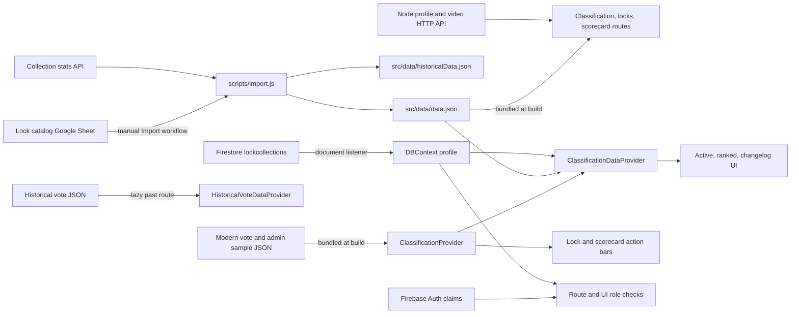

# Current data architecture and flow for Classification

Status: source-code inventory, 2026-10-11. This documents implemented surfaces in `lpu-belt-explorer` for the live-data strategy decision. It does not select a future architecture or claim that preview controls persist data. Product rules, sample counts, and proposed strategies are in the [Classification functionality overview](./classification-functionality-overview.md). The sibling service has a separate [server/API capabilities inventory](../../explore-lpubelts-com-node/internal-docs/classification-server-api-capabilities-overview.md). This inventory is based on local source inspection; no Firebase database, Google Sheet, API, or export job was contacted.

## Architecture at a glance

The current Classification read model is in browser memory. [The parent route](../src/classification/ClassificationParentRoute.jsx) imports the static catalog, mounts `FilterProvider` and `ClassificationProvider`, and passes entries to its child routes. [ClassificationProvider](../src/app/ClassificationContext.jsx) imports modern votes, sample admin actions, and published-changelog snapshots; it groups votes and actions by `entryId` at module load. It has no classification Firestore listener, HTTP request, loading state, or mutation method. Its provider value contains derived lookup functions and arrays. Changing a JSON file reaches users through a new build and deployment, not a live update.

| Source and owner | Current path through this app | Freshness and boundary |
| --- | --- | --- |
| Lock catalog and belt dates: [Sheet import](../scripts/import.js) → [`src/data/data.json`](../src/data/data.json), [`historicalData.json`](../src/data/historicalData.json) | Imported as modules by Classification, lock, scorecard, and lookup code. `id` joins votes/actions by `entryId`; `belt` is the assigned ranking and `currentBeltDate` contributes to the modern-vote milestone. Import also reads a collection-stats API response for popularity/scorecard counts. | Release-versioned. The import reads external services and writes several generated files; it is an approval-gated live-data operation. |
| [Modern vote sample](../src/data/classification-samples.json), [admin-action sample](../src/data/classification-samples-admin.json), [published sample](../src/data/classification-samples-changelog.json) | Direct imports into `ClassificationProvider`; modern votes are also imported independently by [lock-list mapping](../src/locks/LockDataProvider.jsx). | Release-versioned, bundled preview data. Admin actions and changelog are examples, not persisted decisions. Bundled data is available to a browser that downloads the assets even though the route is gated. |
| [Historical vote archive](../src/data/classification-votes-historical.json) | Imported only by the lazy `/classification/past` child through [HistoricalVoteDataProvider](../src/classification/HistoricalVoteDataProvider.jsx). | Release-versioned archive, separate from modern current and previous votes. Its synthetic timestamps order votes within a lock; they are not real event dates. |
| Authenticated member profile: Firestore `lockcollections/{uid}` | [DBContext](../src/app/DBContext.jsx) subscribes once for the signed-in account; [UIContext](../src/app/UIContext.jsx) derives the black-belt UI role after matching the snapshot UID. Profile collections and personal notes feed row filters and scorecard state. | Live while signed in. The existing profile document is a possible integration surface, but it does not currently store Classification votes. |
| API and generated data | [APIContext](../src/app/APIContext.jsx) fetches public profile summaries or an authenticated full profile. [VoteForm](../src/classification/VoteForm.jsx) can request the existing lock-video API to suggest the member's scorecard video URL. [Other data URLs](../src/data/dataUrls.js) supply generated statistics and assets. | HTTP reads, with their own cache and refresh behavior. None is a Classification vote/action/changelog API. |

## Browser read path and current record interpretation

[Routes](../src/app/routes.jsx) lazy-load `/classification`, `/classification/ranked`, `/classification/past`, and `/classification/changelog` under one guarded parent. The first, ranked, and changelog routes each mount a [ClassificationDataProvider](../src/classification/ClassificationDataProvider.jsx). It maps the entire catalog to derived rows, then searches, filters, and sorts in memory. Active rows are unranked locks or locks with a current `Re-opened`, `Pending`, or `Staged` admin action. Ranked rows have an assigned belt and at least one current or previous modern vote; active ranked rows are omitted unless reopened. Changelog rows are the active rows whose status is `Staged`. The past route uses its separate historical provider and only maps catalog IDs with archived votes; archive votes do not enter the modern context.

`ClassificationProvider` treats the later of a ranked lock's `currentBeltDate` and a `Published`/`Settled` action's `updatedAt` as its latest milestone. Modern `type: 'vote'` records at or after that point are current; earlier ones are previous. A `Re-opened` action makes all modern votes current. Its `getUserVote(entry)` matches the signed-in Firebase UID among current votes, while `getAdminAction(entry)` selects an explicit `adminActionId` or the newest action at/after the milestone. Missing actions produce computed `Has Votes` or `No Votes` status. This is preview calculation over arrays, without durable round IDs, uniqueness enforcement, or server-side transitions. [Classification context](../src/app/ClassificationContext.jsx)

The row provider computes `currentVotes`, `previousVotes`, status, active membership, voter names, voted belts, and [vote statistics](../src/classification/classificationVoteStats.js). Vote count, consensus (at least three matching votes and more than half of all current votes), highest belt, and latest vote time use all current modern votes. Voter/belt filters can narrow the vote chips displayed on a row, while those statistics still describe its full current set. Search and sorting run against mapped rows using the shared [filter fields](../src/data/filterFields.js) and [sort fields](../src/data/sortFields.js). A future server summary must preserve or explicitly change this distinction. [ClassificationDataProvider](../src/classification/ClassificationDataProvider.jsx)

The [changelog view](../src/classification/ChangelogMain.jsx) groups staged action rows into additions, samelines, upgrades, downgrades, deletions, and other changes. It can export clipboard text, CSV, or JSON. Selecting a bundled published snapshot by `?id=...` uses that snapshot's action records and `lastPublishedAt`, rather than recomputing history from today's catalog. The Publish control has no handler. [Admin preview](../src/classification/EntryClassificationAdmin.jsx) has disabled save, stage, and delete controls; [vote preview](../src/classification/VoteForm.jsx) has a disabled submit control. These are UI forms and client-side validation, not write paths.

## Data available away from the Classification routes

The [lock list](../src/locks/LockListRoute.jsx) imports the catalog and [LockDataProvider](../src/locks/LockDataProvider.jsx) adds a `Classification` feature by scanning the modern sample for each lock. That feature currently means “has a sample modern vote,” not a canonical active-classification flag. [Entry](../src/entries/Entry.jsx) wraps its action bar in an independent `ClassificationProvider` outside the Classification route. The [scorecard](../src/scorecard/ScorecardRoute.jsx) joins profile activity with static catalog entries; an expandable lock row uses the same [wrapped action bar](../src/scorecard/ScorecardEntry.jsx). These separate provider instances share static imports but would become separate subscriptions if the provider were simply changed to listen to live data.

The [action bar](../src/entries/EntryActionBar.jsx) and [vote button](../src/classification/UserClassificationButton.jsx) can show the signed-in user's current modern vote belt and the preview status. The [vote panel](../src/classification/EntryClassificationVote.jsx) renders its own-vote detail and any `currentVotes`/`previousVotes` already attached to the entry. Classification rows attach those arrays; ordinary lock and scorecard entries generally do not. The shared [vote view](../src/classification/VoteView.jsx) shows Edit on previous modern votes for their owner or a classification admin, while suppressing Edit on the historical route; the vote form still cannot save. The UI has a useful compact-indicator/detail split, but it does not implement an on-demand Classification detail fetch today. The scorecard video suggestion is an existing HTTP integration, not a vote persistence mechanism. [Vote form](../src/classification/VoteForm.jsx)

## Identity, access, and existing live-data mechanisms

[Firebase initialization](../src/auth/firebase.js) creates Auth and Firestore clients. `VITE_DEV_FIRESTORE=true` selects the named `lpubelts-dev` database; otherwise it selects the default database. Test mode can connect to local emulators. [App](../src/app/App.jsx) mounts Auth → Access → DB → API → App → System Message → Scoring → UI providers; profile data uses a route-scoped `ProfileProvider`. [AuthContext](../src/app/AuthContext.jsx) loads true-valued custom claims from the signed-in user's ID token. [AccessContext](../src/app/AccessContext.jsx) derives UI roles and features; its enabled/preview modes only affect presentation. [RequireRoles](../src/app/RequireRoles.jsx) admits the Classification parent for an `admin`, `classificationAdmin`, `lpuMod`, or `classificationTeam` UI role, or the signed-in profile's `blackBelt` role. The profile role is derived from `blackBeltAwardedAt` in the matching `lockcollections` snapshot. Neither a route guard nor a UI feature flag enforces data access to bundled JSON or future backend records. Any live reader/writer needs rules or trusted-server authorization based on verified identity and role evidence.

Reusable live-data patterns already exist, with different ownership and semantics:

| Existing mechanism | Demonstrated capability | Classification-specific limitation |
| --- | --- | --- |
| [DBContext profile listener](../src/app/DBContext.jsx) | One `onSnapshot` per signed-in `lockcollections/{uid}`, plus transactional/merge writes for existing profile features. It exposes profile load/error state and a profile UID. | No vote field or Classification method. A profile copy would require a clear canonical source, update owner, and privacy/rules contract. |
| [Ranking-request listener](../src/rankingRequests/ViewLockRequestsRoute.jsx) | Filtered collection query, `onSnapshot`, application of `docChanges()`, unsubscribe on unmount, and read/refresh [activity logging](../src/rankingRequests/postFirebaseActivity.js). | Ranking requests are a separate domain. This listener is not a Classification query or authorization policy; its query/listener cost and error handling would need fresh design. |
| [ProfileContext](../src/app/ProfileContext.jsx) + [APIContext](../src/app/APIContext.jsx) | Reuse signed-in full profile; use a public reduced summary for others, or an admin-authorized full profile. [GET helper](../src/formUtils/getData.jsx) can attach a Firebase bearer token. | Existing endpoints do not supply Classification votes, worklist summaries, or publication events. The current [API base URL default](../src/data/dataUrls.js) uses `/services`; a new versioned endpoint must be checked against the deployed server mount. |
| [Cloud Functions change trackers](../functions/index.js) | For both default and `lpubelts-dev` databases, document writes to `lockcollections`, `awards`, or `evidence` update a same-database change-index document with `docId`, `changedAt`, `deleted`, and `sourceCollection`. The sibling exporters consume these indexes. | There is no tracker, exporter, or generated summary for Classification votes/actions. Existing tracker collections cannot be assumed to cover new records. |

The sibling Node service already has Firebase-token verification, Firebase Admin access, versioned route/service patterns, and file-backed summaries, as documented in its [server/API inventory](../../explore-lpubelts-com-node/internal-docs/classification-server-api-capabilities-overview.md). It has no Classification API, push channel, or Classification export. Its deployment and generated-data cadence are separate from this frontend's release. Client Firestore listeners can provide immediate snapshots where authorized; existing HTTP requests and static exports have different freshness characteristics.

## Publication and operational flow

Today the changelog view can prepare announcement text and export data. Publication itself is manual: update the lock catalog Sheet, dispatch the [Import workflow](../.github/workflows/import.js.yml), and let a successful import trigger the [Build-N-Deploy workflow](../.github/workflows/build.js.yml). `scripts/import.js` reads Sheet CSV and a collection-stats endpoint, updates catalog/history JSON, and stamps `currentBeltDate` when a lock's belt changes. The build bundles the new catalog; it does not reconcile a Classification action with the Sheet automatically. The Import workflow also commits changed files. These are operational capabilities, not callable UI publication handlers. Live-data scripts, deployments, and production changes remain approval-gated by [project guidance](../.agents/references/firebase-data-safety.md).

[The Classification Sheet extraction script](../scripts/getClassificationSheetData.js) is separate from the catalog import. In the inspected revision `refreshData = false` and `historical = true`, so direct execution processes cached historical tab exports and writes under `src/data/classification/`, including a file named `classification--votes-historical.json`; it does not directly refresh the bundled modern sample or the checked-in historical archive. The [functionality overview](./classification-functionality-overview.md) records the sample's Sheet-of-Record origin, but that provenance should not be read as an active automatic ingestion path. The extractor loads local credentials and can contact Google Sheets when its refresh flag changes, so it was inspected but not run.

## Decision boundaries exposed by this inventory

| Live-data need | Existing part to reuse or adapt | Missing contract before implementation |
| --- | --- | --- |
| Current user's indicator on locks and scorecards | Existing Auth UID, profile listener, wrapped action bar, and static catalog `id` | Canonical vote source; bounded per-user read across visible locks; real-time updates without one listener per row; clear owner for provider instances. |
| Active/ranked worklist and vote details | Current row mapping, filter/sort behavior, milestone semantics, and `DataContext` consumers | Query/projection membership, summary versus private detail shape, read freshness, loading/errors, indexes, and eligible-reader enforcement. |
| Vote and admin-action writes | Auth token/claims, Firestore SDK patterns, preview forms, sibling trusted API patterns | Durable IDs and round model, server/rules validation, owner/admin policy, concurrency, timestamps, idempotency, and publication immutability. |
| Changelog publication and reconciliation | Export formatting, stored-snapshot rendering, catalog import and build workflow | Durable publication event, atomic action transitions, handling of the manual Sheet-to-catalog delay, and a comparison of published intent with currently bundled catalog data. |
| Historical browsing | Lazy static archive and separate provider | Preserve the archive boundary and manual correction process; avoid treating its synthetic timestamps as dates or merging it into modern rounds. |

`firebase.json` declares Functions and emulators but no Firestore rules file. A direct-client Classification design therefore needs an explicit deployed-rules owner and test plan; choosing the sibling API instead requires a new verified-reader/write contract and a separate real-time path where the product requires one. Neither route already exists. [Firebase configuration](../firebase.json), [Functions](../functions/index.js), [sibling API inventory](../../explore-lpubelts-com-node/internal-docs/classification-server-api-capabilities-overview.md)
