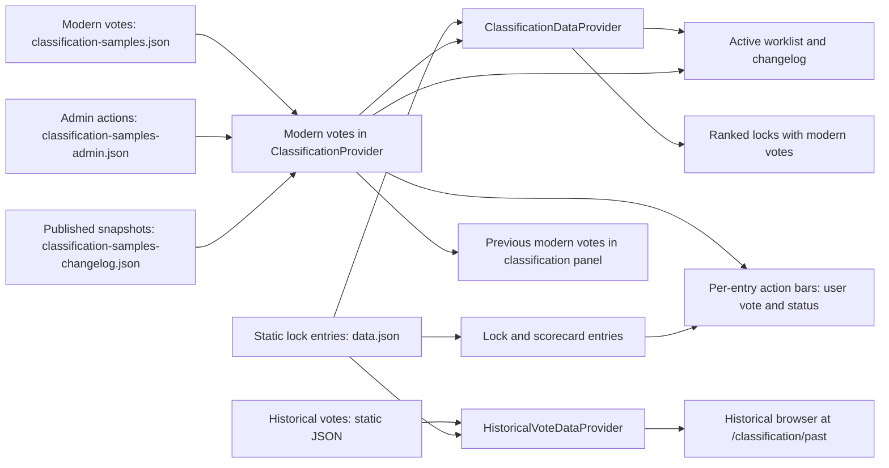

# Classification functionality and data overview

Status: current implementation and recorded product decisions, updated 2026-10-12. This is an inventory and evaluation brief, not an approved Firebase design. JSON record counts describe the files in this revision; tracking-sheet counts below are owner-reported planning inputs, not live service counts.

## Purpose and scope

Classification lets eligible members inspect proposed lock rankings, see belt votes, and prepare administrative ranking decisions. The current site is a read-only preview backed by bundled JSON. The next design needs to make modern votes and supporting actions durable and writable while keeping historical votes in a static archive. It also needs to serve a classification worklist, a ranked-lock browser for modern votes, the signed-in member's vote indicator on lock and scorecard entries, and vote details opened on demand.

The term **modern vote** below means a record in `src/data/classification-samples.json`, extracted from the [Sheet of Record (S.O.R.)](https://docs.google.com/spreadsheets/d/1OJSQki_FDe8KtgQ0b1BJ9I21R6bnyNcFAZmQVtgx438/edit?gid=1613106571#gid=1613106571) using `scripts/getClassificationSheetData.js`, according to the project owner. The sample is incomplete; the full migration source will use the same format. **Historical vote** means a record in `src/data/classification-votes-historical.json`; this archive remains a repository JSON file, with infrequent manual corrections. `ClassificationProvider` reads only modern votes. Its current **previous votes** are modern records before a ranking milestone. The historical archive has a separate provider and is displayed only at `/classification/past`. Product usage of “previous votes” refers only to previous modern rounds.

## Current user journeys and implementation status

| Surface | What works now | Current boundary |
| --- | --- | --- |
| `/classification` | Role-gated worklist of active locks. Search, filters, sorting, vote chips on rows, status flags, and expandable lock/vote details. | The expanded vote panel lists individual votes without repeating the row's “current votes” chip summary. Uses bundled modern votes and admin actions. Vote and admin forms are previews with disabled save controls, including the admin form's `Publish Now` placeholder. |
| `/classification/ranked` | Role-gated browser of ranked locks with modern votes. It excludes active locks unless their status is `Re-opened`, so a reopened lock also appears on the active worklist. Reuses the worklist's search, filters, sorting, vote chips, and expandable details. | Uses the same bundled modern votes and admin actions. Both pages show current and previous modern vote chips; previous votes have a clock icon and a “previous” tooltip. Vote counts, statistics, voter/belt filters, and voter-name search use current votes; a lock with only previous modern votes can appear here with a current vote count of zero. |
| `/classification/past` | Role-gated historical-vote browser with search, filters, sorting, vote chips, and read-only vote details on expanded locks. Only locks with matching historical votes appear. | Uses the bundled historical JSON archive. `VoteView` hides Edit on this route. Historical votes whose `entryId` is absent from the lock catalog have no row. Synthetic timestamps represent within-lock sequence, not actual dates. |
| `/classification/changelog` | Shows current staged actions and a date menu for previous published changelogs. Both views group additions, samelines, upgrades, downgrades, deleted locks, and other changes, and offer clipboard, CSV, and JSON export. The selected published changelog is addressable with `?id=...`; its action snapshots determine its sections and text. Admins can open the preview edit form on staged rows, while published rows are read-only. | Uses nine test-only admin actions and one bundled published changelog snapshot. The visible Publish button and edit form have no save handler. Published records and their dates are static until a site update. |
| Lock list / lock details | Eligible users see their current modern vote's `votedBelt` in a belt icon and can open the vote panel to see their vote details. | The vote panel hides other users' current and previous votes outside Classification and no longer has a “current votes” chip summary. Lock entries are also not enriched with the worklist's vote arrays. The “Classification” feature filter is inferred from the modern sample votes; the static sample is still bundled, so the display guard alone does not reduce data loading. |
| Scorecard lock rows | An owner or admin who can expand a lock row can use the same action bar, belt icon, and on-demand vote panel. | The scorecard entry also lacks worklist vote arrays. Availability follows scorecard row access and the action-bar feature gate. |
| Previous modern vote detail | On an expanded lock in the active worklist or ranked browser, modern records before the latest ranking milestone appear in a “Previous votes” section, except while the lock is `Re-opened`. The owner or a classification admin sees an Edit control on these previous votes. | Reopening makes every modern vote current. Historical records are absent from this panel and from lock/scorecard panels; the vote form's save control is still disabled. |

The route guard accepts the authenticated `admin`, `classificationAdmin`, `lpuMod`, or `classificationTeam` claim, or a black-belt award in the signed-in user's loaded `lockcollections` profile. `UIContext` derives that profile role from `DBContext` and waits for a profile snapshot associated with the current user, so a previous account's profile cannot grant access during an account switch. The navigation menu shows Classification to the same eligible users. All of these eligible users may read all modern votes, including comments and media links. Only `admin` and `classificationAdmin` may create or edit admin actions. `AccessContext` treats an authenticated `admin` claim as also having the `classificationAdmin`, `lpuMod`, `classificationTeam`, and `qaUser` UI roles. The four classification claim roles provide `classificationVote`, while `admin` and `classificationAdmin` also get `classificationAdmin`; a black belt without one of those claims can browse Classification but does not receive vote or admin controls. In development, the account menu can preview a subset of the signed-in account's claimed UI roles, including moderator or classification-team views for an admin, or a member view; the choice resets on reload. These are client presentation rules. Future protected reads and writes need rules or trusted server authorization that checks the appropriate claim or trusted profile field. UI switches and role previews do not change Firebase claims or grant backend access.

Key entry points: [routes](../src/app/routes.jsx), [parent route](../src/classification/ClassificationParentRoute.jsx), [claim access policy](../src/app/AccessContext.jsx), [profile UI access](../src/app/UIContext.jsx), [action bar](../src/entries/EntryActionBar.jsx), [scorecard row](../src/scorecard/ScorecardEntry.jsx), [navigation menu](../src/nav/menuConfig.jsx).

## Current data flow

`ClassificationParentRoute` mounts `FilterProvider` and `ClassificationProvider` for the classification children, passing the static lock catalog through the router outlet. `ClassificationProvider` groups only the 183 modern votes by entry once when the module loads. `ClassificationDataProvider` then maps **every** lock to a derived row for the active worklist, ranked browser, and changelog. It computes current/previous modern votes, status, vote counts, consensus, highest voted belt, latest vote date, searchable voter names, and filter values. The active worklist includes unranked entries and ranked entries with an active classification admin action. A modern vote by itself does not put a ranked entry on the active worklist. The ranked browser includes ranked entries with any modern vote, current or previous, when they are inactive or `Re-opened`; other active ranked entries remain on the active worklist only. The admin preview selects its action through `ClassificationProvider.getAdminAction`, honoring an explicit action ID or the latest action at or after the ranking milestone. It pre-fills only an action whose status is not `Published`; a published or missing action starts a new `Pending` form. Classification route action bars use the parent's `ClassificationProvider`; lock and scorecard action bars mount their own providers. The static grouping is shared, but the provider instances remain separate; this matters when replacing the arrays with subscriptions or queries.

The lazy `/classification/past` child loads `HistoricalVoteDataProvider` and the archived JSON. It groups historical records by lock, builds rows only for catalog locks with archive records, and shows filtered vote chips and read-only details. The shared classification row component suppresses the vote/admin action bar, and `VoteView` suppresses Edit on this route. The classification parent still mounts the modern context on `/classification/past`, but the historical browser uses its own data provider. Historical records do not enter `currentVotes` or `previousVotes` on modern worklist rows. Historical vote counts and highest-belt sort values come from the archive; voter/belt filters narrow the displayed votes while counts still describe all archive votes on a lock. The derived `latestVoteDate` uses synthetic `createdAt` values and must not be treated as an actual event date.

The lock list's `LockDataProvider` independently scans the modern sample vote array to add the `Classification` feature label. The scorecard data provider combines scorecard activity with static lock entries but does not add classification vote arrays. Today the action bar's user vote comes from its own `ClassificationProvider`, and its expanded detail receives whichever vote arrays the entry already has. A future data service should define one owner for each read and an explicit contract for a compact per-entry indicator versus full details.

Sources: [classification context](../src/app/ClassificationContext.jsx), [classification row mapping](../src/classification/ClassificationDataProvider.jsx), [historical row mapping](../src/classification/HistoricalVoteDataProvider.jsx), [lock row mapping](../src/locks/LockDataProvider.jsx), [scorecard row mapping](../src/scorecard/ScorecardDataProvider.jsx), [action bar](../src/entries/EntryActionBar.jsx).

### Current interpretation of a classification round

`getLatestMilestone(entry)` takes the later of the lock's `currentBeltDate` and the `updatedAt` values of its `Published` or `Settled` admin actions, or the Unix epoch if neither exists. Normally, a modern record with `type: "vote"` and `updatedAt >= milestone` is **current**; an earlier modern vote is **previous**. While the current admin action is `Re-opened`, all modern votes for the lock count as current and none are previous. `getUserVote` returns the first matching current vote for the signed-in Firebase UID after sorting newest first, including an earlier vote when reopened. A previous modern vote also shows Edit in `VoteView` for its owner or a classification admin outside the changelog, using that vote as the form's base record. `loggedInUserVotes` and `allVotes` expose modern votes only. Historical records are outside this round model and appear only in the historical browser. There is no separate round identifier or server-enforced uniqueness rule in this preview. Future publication and previous-modern-round storage need an explicit model that preserves one vote per member per lock across reopening.

The latest admin action at or after the milestone supplies its status. With no such action, status is `Has Votes` or `No Votes`. A lock is active if its assigned belt is `Unranked`, or a current admin action has status `Re-opened`, `Pending`, or `Staged`. The latter states represent the reopened classification workflow for ranked locks. `Has Votes` is only a fallback status and does not activate a ranked lock. The changelog selects active rows with `Staged` status, including staged unranked additions, Sameline, and Delete actions. `Settled` disables the add-vote affordance, although an existing vote still shows an Edit control in this preview. The preview form offers `Draft`, `Pending`, `Staged`, `Published`, `Re-opened`, and `Settled`; `Error` appears in the UI status configuration but not the form, while `Has Votes` and `No Votes` are computed fallbacks. Its `Publish Now` button is a disabled placeholder for publishing the current action individually, outside the staged changelog batch.

The previous-changelog menu reads bundled publication records with nonempty `changes`, sorted by `lastPublishedAt` descending. Each `changes` item is a full admin-action snapshot joined to a catalog lock by `entryId` when available; its stored name and belt still render if that lock is absent. `previousBelt` and `updatedBelt` classify the past ranking change even if the catalog's current belt differs. Selecting a date sets the `id` query parameter. The current-changes option removes it. The route suppresses vote edit controls, and published action rows have no admin edit control. Unknown IDs fall back to current changes. Published changelogs show decisions; they do not need to display the votes from each modern round.

Vote statistics count all current modern records, with consensus defined as at least three votes for one belt and more than half of current votes for that belt. Voter/belt filters narrow the `currentVotes` shown in a worklist row, but aggregate statistics use all current votes. A move to server summaries must preserve that distinction and the current sort/filter contract, or deliberately change it.

Sources: [classification context](../src/app/ClassificationContext.jsx), [vote statistics](../src/classification/classificationVoteStats.js), [filter fields](../src/data/filterFields.js), [sort fields](../src/data/sortFields.js), [vote panel](../src/classification/EntryClassificationVote.jsx).

## Existing record contracts and dataset observations

| Dataset | Size in this revision | Fields and role | Loading behavior |
| --- | --- | --- | --- |
| [Modern sample votes](../src/data/classification-samples.json) | 183 records, about 83 KB; 109 lock IDs, 62 distinct `userId` values | `id`, `entryId`, `userId`, `displayName`, `votedBelt`, `comment`, `source`, `type`, `createdAt`, `updatedAt`; sheet-related fields include `sheetRow`, `lockname`, `ranking`, `sheetLink`. | Static import by classification context **and** lock-list mapping; included in application bundles. Extracted from the S.O.R.; the complete migration source will use the same format. |
| [Sample admin actions](../src/data/classification-samples-admin.json) | 10 test records, about 5.8 KB; 9 lock IDs | `id`, `entryId`, `entryName`, `userId`, `displayName`, `status`, `action` (`Belt Change`, `Sameline`, or `Delete`), `updatedBelt` for belt changes, `samelineLock` with the retained lock's ID/name/belt for samelines, `note`, optional `adminNote`, `omitFromChangelog`, `lastPublishedAt`, `source`, `createdAt`, `updatedAt`. An older settled sample still has `includeInChangelog`; the preview form uses `omitChangelog`. | Static import by classification context; the admin preview reads its selected action through `getAdminAction`. These are test data, not migration records; future real admin actions need a durable owner. |
| [Sample published changelogs](../src/data/classification-samples-changelog.json) | 1 published record with 1 change | Changelog `id`, `lastPublishedAt`, metadata, and a `changes` array of full admin-action snapshots. The sample action includes `entryId`, `previousBelt`, and `updatedBelt`. | Static import by classification context; the date menu omits empty changelogs. These are preview records, not a live publication service. |
| [Historical votes](../src/data/classification-votes-historical.json) | 2,113 records, about 783 KB; 458 lock IDs, 166 distinct `userId` values | `id`, `type: historicalVote`, `entryId`, `votedBelt`, `comment` on most records, `userId`, `displayName`, `createdAt`. No `updatedAt` or `source` is present. | Static import by the lazy `/classification/past` route's data provider. The archive remains static and is not part of `ClassificationContext`. |
| [Lock catalog](../src/data/data.json) | 1,006 lock entries; 50 with `currentBeltDate` | Stable `id`, assigned `belt`, and other lock metadata; `currentBeltDate` is read by classification logic. | Bundled static catalog used to join records by `entryId`. |

For planning beyond the incomplete modern sample, the project owner reports **350 modern votes across 250 locks** in the [tracking sheet](https://docs.google.com/spreadsheets/d/1OJSQki_FDe8KtgQ0b1BJ9I21R6bnyNcFAZmQVtgx438/edit?gid=69931480#gid=69931480) as of 2026-10-11. Those 250 locks are currently being voted on in the active classification worklist. They expect both counts to increase under the new system, but by no more than twofold: plan for up to roughly **700 modern votes across 500 active locks being voted on**. Up to **25 locks** may have an admin action or be staged for a changelog at a time, with no more than **two or three concurrent reviewers** expected.

Dates in the JSON are parseable strings. The preview vote form collects `votedBelt`, optional `comment`, and optional `mediaUrl`, with a helper to use the member's scorecard video URL. No sample modern vote contains `mediaUrl`. The form currently performs client checks for a required belt and URL syntax, but it cannot submit. The admin preview collects status and action, then shows a target belt for Belt Change or a retained-lock search for Sameline; Delete has neither target field. It also shows changelog note, optional admin note, omission preference, and a rendered changelog preview. Save, stage, delete, and publish controls remain inactive. Future persisted fields, validation, and authorization must be specified together rather than inferred from disabled controls.

Data preparation and remaining caveats:

- The lock catalog contains `currentBeltDate` on 50 entries. The import script preserves that date in both the lock-history record and generated lock entry. Under the current milestone rule, 181 modern votes are current and one is previous; the published sample action supplies the boundary for that previous modern vote. Locks without a belt date still use the epoch unless they have a `Published` admin action.
- The 183 modern votes have unique `(entryId, userId)` pairs and all have `type: "vote"`. Duplicate pairs and special type values have been removed from the modern migration data. There are no `userId: "unknown"` sentinels in the current modern sample. Thirty-four modern votes use 23 synthetic `u_...` IDs for unknown users; the modern migration and read model must support these IDs without collapsing them into one voter. If any modern votes are attributed to members, the full modern migration source must carry those corrections before import.
- The historical JSON contains 477 historical votes across 96 synthetic `u_...` user IDs and 57 `Unknown` display names. Four historical votes reference two lock IDs absent from the current catalog, so those records have no row in the current historical browser. Historical votes with synthetic IDs may be attributed to members through manual corrections in `src/data/classification-votes-historical.json`. Keep other archival records intact while defining display and lookup behavior for incomplete data.
- The checked-in historical archive uses artificial `createdAt` timestamps beginning 2026-10-01, with minutes added by vote-column position. The resulting order represents the vote sequence within a lock's spreadsheet row; actual calendar dates are unknown. The historical provider uses this order within a lock. The historical browser omits a cross-lock “Recently Updated” sort because these timestamps are not event dates. The script's current active path extracts modern votes from the S.O.R.; its historical-export path is commented out and writes a different filename (`classification--votes-historical.json` under `src/data/classification/`).
- `classification-samples-admin.json` is entirely test data. It demonstrates the preview workflow but should not be imported as actual decisions. The checked-in modern vote extract is incomplete; obtain the full source in the same format for migration and retain distinct synthetic voter IDs.

The JSON observations came from a local, read-only count of the workspace files on 2026-10-09. The tracking-sheet counts, growth expectation, admin-action volume, and reviewer estimate are the project owner's report; the linked sheets were not accessed for independent review. No live Firebase or Sheet data was accessed. Sources: [classification extraction script](../scripts/getClassificationSheetData.js), [lock import date logic](../scripts/import.js), [vote preview](../src/classification/VoteForm.jsx), [admin preview](../src/classification/EntryClassificationAdmin.jsx).

## Read and write requirements for the next design

| Use case | Minimum data and access pattern | Freshness / consistency need |
| --- | --- | --- |
| Lock and scorecard vote icon | Current authenticated user's `votedBelt` and whether the lock accepts votes, keyed by `entryId`; ideally batched for visible rows. The existing `lockcollections` profile subscription is one possible place for a copy of the user's votes. | The signed-in user's own vote must update in real time, including on lock and scorecard routes. Avoid one subscription per row. |
| On-demand vote detail | Full current user's modern vote (`comment`, `mediaUrl`, dates) on lock and scorecard routes. All modern votes, including other users' comments and media URLs, are needed only for an opened entry inside Classification. | Subscribe to the owner's vote outside Classification; fetch other-vote detail only when a Classification panel opens and release it on route exit. Near real-time updates are sufficient for non-admin readers; if explicit refresh is needed, indicate it. |
| Classification worklist | Active lock IDs, effective status, current modern votes, voter/belt filters, vote statistics and sort keys, with staged actions. | Live updates for logged-in admins. Near real-time updates are sufficient for other classification users; explicit refresh is acceptable if the UI indicates new data is available. |
| Ranked modern-vote browser | Ranked lock IDs with at least one current or previous modern vote, plus current vote statistics and previous vote details. | Keep its membership and vote detail fresh under the same role policy as the active worklist. |
| Historical detail | Historical votes by lock ID, loaded from repository JSON through the `/classification/past` route. | Versioned with site releases; separate from modern current and previous votes, modern counts, and writable records. |
| Member vote write | Create one modern vote per authenticated member per lock, edit that vote on reopening, and allow the owner or a classification admin to delete it at any time; validate belt/comment/media and authenticated actor. | All modern votes count as current when a lock is `Re-opened`. Duplicate requests and concurrent edits need deterministic behavior. |
| Admin workflow | `admin` and `classificationAdmin` may create/update status and decision, stage and publish a changelog, or use `Publish Now` to publish one decision directly from its form without publishing other staged actions. They may also settle/reopen actions. | Both publication paths need the same server-enforced authorization, actor and timestamp stamping, and immutable history. A published belt reaches the static catalog through the manually triggered Sheet import. |

The last two rows are requirements to design, not implemented capabilities. In the current manual publication workflow, the changelog is announced using text and data generated by its Export button, the [lock catalog Google Sheet](https://docs.google.com/spreadsheets/d/1IDuO-g0fSkElbiDJFU2F10V3I1o4w5FhW88k1Cdsn2c/edit?gid=0#gid=0) is updated, and the [GitHub Import action](../.github/workflows/import.js.yml) is run. That action runs `npm run import` (which invokes `scripts/import.js`); its successful completion triggers the [Build-N-Deploy workflow](../.github/workflows/build.js.yml) to publish the site. A directly published change still needs the manual Sheet update and import before its belt appears in the static catalog. The goal is for published changes to be live on the site within 2–3 days. Reconciliation is manual and needs a view showing each publication's intended changes alongside current site data for its included locks. Comparing the site display against the Sheet and tracking implementation progress or completion are not current requirements. A later phase may evaluate updating the Sheet from the site's publication process through the Google Sheets API. The publication design must account for the manual Sheet-to-catalog step so displayed belts and round boundaries remain consistent. The sibling server repository owns exports and API services.

## Data strategy options to evaluate

| Approach | Fit and advantages | Main costs and questions |
| --- | --- | --- |
| **Firestore documents queried by the client** for modern votes and actions | Matches the application's existing Firebase Auth and Firestore usage. Per-user and per-entry queries can update views promptly. A bounded role-gated worklist may be feasible, subject to analysis beyond the incomplete 183-record sample. | Requires deployed security rules for every read/write, indexes for `entryId`, `userId`, round/status and ordering, and a deliberate way to avoid a listener per lock row. Full vote comments and media URLs must remain readable only to eligible classification-site users. |
| **Firestore source plus a trusted API/read projection** | Centralizes policy and can return a compact per-user indicator, a worklist summary, and details separately. It can join static lock metadata and record publication decisions. Fits the existing server/API ownership if that service is chosen. | Adds server endpoint, cache/invalidation, and deployment ownership. Worklist search/filter over individual voter names or belts may require a richer projection or detail fetch. The sibling server repository must be inspected before choosing its implementation. |
| **Firestore source plus generated static summaries** | Cheap list reads and good fit for a catalog that already ships static data. Modern vote details could still be fetched on demand. | Summary freshness follows an export/build pipeline; this is a poor fit for immediate vote feedback unless paired with a live per-user read. A static export must not include data that is meant to remain access-controlled. Exporters are live-data operations and approval-gated. |

All approaches keep historical votes in release-versioned repository JSON. The historical JSON is now imported by the lazy `/classification/past` child rather than `ClassificationContext`, reducing the archive's presence in lock, scorecard, and current-classification paths. The 2026-10-11 test build emits a 661.98 KB `HistoricalVotesRoute` chunk (133.47 KB gzip); the archive is therefore a substantial cost only when that route is loaded. A useful decision is likely a combination of a durable source for modern votes/actions, an owner-only indicator plus minimal entry state outside Classification, a route-scoped worklist summary inside Classification, and on-demand other-vote detail there. The option assessment should compare measured data size, update frequency, role visibility, latency, Firestore read costs, offline behavior, and operational ownership. It must support live worklist updates for admins and real-time feedback for each user's own vote without downloading other people's vote chips on ordinary lock or scorecard routes. Do not use a single giant document or an unbounded per-row subscription to reproduce the current in-memory array.

Before implementing any option, specify the record and round model:

1. Choose stable modern vote IDs and enforce one editable modern vote per `(entryId, userId)` across reopening; retain original source IDs separately if needed. Support distinct synthetic `u_...` users in the modern vote data and define revision history versus overwriting the effective vote.
2. Choose an explicit round/decision ID or a durable milestone for publication history and previous-modern-round display. On `Re-opened`, treat all modern votes on the lock as current and allow a returning member to edit their existing vote. Keep the historical static archive separate.
3. Define mutable admin work items and immutable publication events for both batch changelogs and direct single-action publishing. A direct publication must save the form's decision and publish that action together, leave unrelated staged actions untouched, and retain a snapshot that can be reviewed after later edits or catalog imports. Apply the decided status transitions and align the sample's `omitFromChangelog` and older `includeInChangelog` fields with the form's `omitChangelog` field.
4. Enforce read access to all modern votes, comments, and media URLs for `admin`, `classificationAdmin`, `lpuMod`, `classificationTeam`, and signed-in users with the planned `blackBelt` Auth claim. The current route derives Black Belt from the profile; the [public-release recommendation](./classification-public-data-recommendation.md) records the claim decision and its late-phase implementation. Access to linked media outside the classification site depends on its host and must be assessed separately. Current bundled JSON is downloadable as site assets and cannot establish private-data policy.
5. Define server-side field validation, actor stamping, timestamp source, and idempotency. Claims, Firestore rules, and/or trusted server code must enforce the decided edit/delete permissions; `accessInfo` only controls presentation.
6. Decide where the lock's effective classification flag, assigned belt, round boundary, and aggregate vote statistics live, who updates them, and how they reconcile with the manual Google Sheet import into static `data.json` and exports.

No Firestore rules file is declared in this repository's `firebase.json`, so a client-write design needs a separately reviewed and testable deployed-rules plan. Existing `DBContext` uses Firestore, but it has no classification read/write API. The nearby ranking-request subscription is an example of the SDK pattern, not a classification authorization contract. Sources: [Firebase configuration](../firebase.json), [DBContext](../src/app/DBContext.jsx), [ranking-request route](../src/rankingRequests/ViewLockRequestsRoute.jsx), [Firebase safety reference](../.agents/references/firebase-data-safety.md).

## Suggested evaluation and implementation sequence

1. **Resolve remaining product rules:** define eligible voter criteria. Keep the decided reader/admin roles, visibility of modern votes with comments and media links, one modern vote per member per lock, vote deletion rights, admin action transitions, and permitted attribution of historical votes with synthetic user IDs in the design.
2. **Define canonical records and queries:** document the modern vote, round, admin decision, publication event, and compact indicator/summary contracts. Make each UI read above map to one bounded query or endpoint; estimate query/index/read cost using the owner-reported vote and active-lock range, up to 25 locks with admin actions or staged changes, and up to three concurrent reviewers.
3. **Prototype with synthetic data:** test claim-based authorization, round transitions, duplicate submissions, and two simultaneous edits against emulators or an isolated API. Add rules tests if using direct Firestore reads/writes. Do not use production credentials or live data for automated tests.
4. **Migrate readers before writes:** replace the sample-source dependencies in `ClassificationProvider` and `LockDataProvider` with a shared owner-vote/minimal-state reader and a Classification-scoped summary/detail reader, which also supplies the admin preview through `getAdminAction`. Use `lastPublishedAt` for published-changelog dates throughout the new data contract and UI. Keep the worklist's aggregate/filter semantics and the lock/scorecard indicator/detail split explicit. Verify that lock and scorecard navigation never loads other users' vote chips or detail. Preserve loading, error, and empty states.
5. **Enable writes and publication separately:** persist votes and admin work items with server-enforced policy. Then enable both staged-changelog publishing and `Publish Now` for one action, using the same publication history and round-boundary rules. Connect both paths to the existing manual Google Sheet-to-catalog import process and provide a view comparing each publication's intended changes with current site data for its included locks. Use that view for manual reconciliation after import; no Sheet-to-site display validation or implementation progress tracking is required.
6. **Retire sample imports and validate:** compare expected counts, identities, and representative records with the complete modern source in the same format; exclude the test-only admin actions and keep historical votes in repository JSON for the separate past route. Run focused classification/context tests, broader frontend tests for shared data-flow changes, and targeted browser/emulator coverage for the authenticated journey.

Existing tests cover milestone/current-vs-previous behavior for modern votes, reopening all modern votes as current, settled boundaries, previous-vote chip labels, active and ranked list membership, staged Sameline/Delete actions and changelog exports, exclusion of historical records from the context, separate read-only historical display, vote filters and aggregate counts, claim and profile route access, toolbar navigation, role features, scorecard vote controls, and disabled preview controls: [context tests](../tests/vitest/ClassificationContext.test.jsx), [list tests](../tests/vitest/ClassificationDataProvider.test.jsx), [changelog tests](../tests/vitest/ClassificationChangelog.test.jsx), [historical browser tests](../tests/vitest/HistoricalVoteDataProvider.test.jsx), [access tests](../tests/vitest/ClassificationAccess.test.jsx), [toolbar tests](../tests/vitest/ClassificationToolbar.test.jsx), [vote display tests](../tests/vitest/EntryClassificationVote.test.jsx), [preview tests](../tests/vitest/ClassificationPreview.test.jsx). There is no classification end-to-end journey in `tests/e2e` yet.

## Decisions recorded for the strategy review

- All classification-site users may see all modern votes, including comments and media links. Site access is granted by the `admin`, `classificationAdmin`, `lpuMod`, or `classificationTeam` claim, or the `blackBelt` profile role. Only `admin` and `classificationAdmin` may create or edit admin actions.
- For public release, store `blackBelt` as a Firebase Auth custom claim derived from a verified award and use the verified claim for Classification read authorization in the site, Firestore rules, and Node API. The award/profile remains the source of award history; `blackBelt` grants no vote or admin writes. Implement claim synchronization and backfill in the late release phase before public reads depend on it, as specified in the [data recommendation](./classification-public-data-recommendation.md).
- The checked-in modern sample is incomplete. The complete migration source will use the same format. Duplicate `(entryId, userId)` pairs and special type values have been removed; distinct `u_...` IDs for unknown users must be supported.
- Historical votes with synthetic user IDs may be attributed to members. Attribution corrections are made manually in `src/data/classification-votes-historical.json`; this archive remains a JSON file in the repository because major changes after launch are not expected.
- A member has one editable modern vote per lock. A previous modern vote remains editable by its owner or a classification admin; editing it updates the same record. When a lock is `Re-opened`, all its modern votes are current. The durable data model must preserve this behavior.
- A modern vote may be edited by its owner or an authorized admin. An edit saves all editable vote fields, including `votedBelt`, `comment`, and `mediaUrl`, and sets `updatedAt` to the time of the edit. An admin edit preserves the vote's original `userId` and `displayName`.
- The owner of a modern vote, identified by its `userId`, or a classification admin may delete it at any time. The backend must verify the authenticated user ID or an `admin`/`classificationAdmin` claim.
- When an admin action's status changes, its `updatedAt` is set to the time of the change and the UI reflects the new status.
- An `admin` or `classificationAdmin` may change any action whose status is not `Published` to `Draft`, `Pending`, `Staged`, `Published`, `Re-opened`, or `Settled`, and may delete any such action. Editing or deleting a `Published` action is outside the required workflow and is not offered by the UI.
- The admin action form pre-fills only an action whose status is not `Published`. After publication, it starts a new `Pending` action instead of editing the published record.
- Publishing a changelog sets its status to `Published` and updates its `lastPublishedAt` and `updatedAt`. Every action included in that publication is set to `Published`, with its `lastPublishedAt` and `updatedAt` updated to the publication time. Use `lastPublishedAt` throughout the durable changelog records and date display.
- `Publish Now` lets an `admin` or `classificationAdmin` publish the action in the admin form as a single change, without staging it in or publishing the broader changelog. The operation saves the current form decision and publishes only that action; other staged actions remain staged. It sets the action's status to `Published` and its `lastPublishedAt` and `updatedAt` to the publication time, and records an immutable single-change publication snapshot with that same time and the authenticated actor. It must use the same authorization, validation, round-boundary, historical display, and manual Sheet-to-catalog follow-through as batch publication. The current button is a disabled preview; this behavior is a requirement for the writable design.
- “Previous votes” refers to previous modern rounds, not the static historical archive.
- The ranked-lock browser and its per-lock panels are sufficient for finding previous modern votes; no separate round browser is needed.
- Each lock's “Previous votes” section remains one combined list, without grouping by publication round.
- Published changelogs show classification decisions and do not need to display the votes from each round.
- The current changelog publication process is manual: announce the changelog using text and data from its Export button, update the lock catalog Google Sheet, and run the GitHub Import action. The action imports the Sheet into the static catalog, then a successful run triggers the site build and deployment. The operational goal is to have published changes live on the site within 2–3 days. Updating the Sheet through the Google Sheets API when publishing a changelog on the site is a possible later phase.
- Reconciliation after import is manual. Provide a page or view that shows a published changelog's intended changes alongside current site data for the included locks. There is no current requirement to validate the site's display against the Sheet or track the implementation process's progress or completion. The 2–3 day freshness goal remains an operational target rather than an application-tracked deadline.
- Logged-in admins need a live worklist while using Classification. Near real-time updates suffice for other classification users, with explicit refresh allowed when the UI indicates it is needed. Each user's own vote must update in real time on lock and scorecard routes, without subscribing to other voters' chips or fetching their details there. The [data recommendation](./classification-public-data-recommendation.md) uses an owner-vote subscription plus minimal matching entry state to determine whether the vote is current.
- Use the owner-reported range of 350–700 modern votes across 250–500 active locks being voted on, up to 25 locks with admin actions or staged changes at a time, and no more than three concurrent reviewers as the capacity planning basis for worklist queries and subscriptions.
