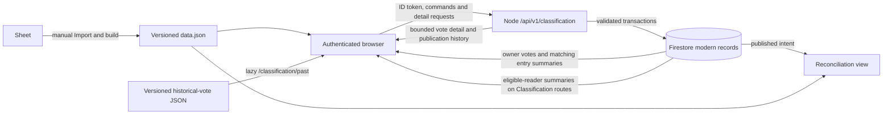

# Classification data and release workflow recommendation

Status: design recommendation with a recorded Black Belt authorization decision and Phase 1 local contract review, 2026-10-12. This is a proposed contract for implementation review, not an existing API, deployed ruleset, or migration plan already run against live data. It uses the [functionality and product decisions](./classification-functionality-overview.md), the [frontend data inventory](./classification-data-architecture-capabilities.md), and the [sibling server inventory](../../explore-lpubelts-com-node/internal-docs/classification-server-api-capabilities-overview.md). No live Firebase database, Sheet, API, exporter, or deployment was contacted for this document. The target editions, deployed rules owner, live API mount, and trusted award provenance still require confirmation before physical implementation.

## Recommendation

Use **Firestore as the durable source of truth for modern classification data**, with the sibling Node service as the **only writer and the authenticated detail API**. Let the React app subscribe to the signed-in member's votes and the matching entry summaries for live indicators; while a Classification route is open, subscribe to the full role-gated set of compact per-lock summaries and reuse it for the indicator. Fetch complete vote detail and published changelogs through bounded, authenticated API requests. Keep the lock catalog and historical-vote archive in their existing release-versioned JSON files. Keep the Sheet update and GitHub Import/build workflow manual for the first public release.

This uses existing Firebase Auth and the sibling service's verified-token/Firebase Admin/API patterns. The signed-in profile listener continues to supply profile data, while a derived `blackBelt` Auth claim will authorize Classification reads for Black Belt members at public release. It also avoids making a generated public file the source of private vote details or making one HTTP poll per lock stand in for live feedback. It **does require new Firestore rules for these client reads**, new server endpoints and tests, and deployment coordination; none of these exists yet. A direct-client alternative appears below.

The recommendation is deliberately a small hybrid: the server owns every mutation and sensitive detail response; Firestore's existing browser SDK supplies the real-time reads. Put the owner-vote and matching-summary subscriptions in one shared data owner used by lock and scorecard routes. Put the full summary subscription in the Classification parent and tear it down on exit; reuse those results while it is mounted. Do not turn each `EntryActionBar` or lock row into an independent listener.

### Recorded Black Belt authorization decision

For the public release, store `blackBelt: true` as a Firebase Auth custom claim on eligible users and use that **verified claim** in the Classification route policy, Firestore read rules, and Node API reader middleware. Keep the awarded status/date in the authoritative award/profile data; the claim is a derived access entitlement, not the source of award history. A Black Belt claim grants Classification **read** access only. It does not grant `classificationVote`, `classificationAdmin`, or any write permission. Existing `admin`, `classificationAdmin`, `lpuMod`, and `classificationTeam` claims retain their current access.

Implement claim creation and synchronization in the late release phase below, before any public Classification reads rely on it. A privileged process must verify the underlying award before setting or clearing the claim; do not turn a client-writable `blackBeltAwardedAt` field directly into an Auth privilege. Handle grant, removal, and backfill, preserve all other custom claims when calling `setCustomUserClaims`, and update the site's token observer/refresh behavior so claim changes reach the UI. Plan for already-issued tokens to retain old claims until refresh, and define the acceptable delay for removal. The Firebase Auth project is shared by the default and `lpubelts-dev` Firestore databases, so the claim is user-level across both; test that scope explicitly. [Firebase custom claims](https://firebase.google.com/docs/auth/admin/custom-claims), [ID token observer](https://firebase.google.com/docs/reference/js/auth.auth).

## Source of truth and record contracts

The following are logical collections and fields, not a migration script. Use stable, deterministic IDs and keep the source pair fields without trusting browser-provided ownership. Keep `entryId` equal to the static catalog's lock ID. Store server timestamps as Firestore timestamps and serialize ISO dates at the API boundary. Keep a numeric `revision` for conditional edits and an `idempotencyKey`/operation record for retried commands.

### Phase 1 target inventory from local source

| Boundary | Development | Production | Confirmation still needed |
| --- | --- | --- | --- |
| Firebase project and Firestore database | The frontend's `VITE_DEV_FIRESTORE=true` selects `lpubelts-dev`; the sibling API runtime contract also requires `FIRESTORE_DATABASE_ID=lpubelts-dev` in the shared `lpu-belt-explorer` project. | The normal frontend selects Firestore's `(default)` database; the sibling runtime treats `(default)` as production access. | Verify the actual provisioned database IDs **and editions** in the target project before choosing indexes, query limits, or a rules deployment command. The repository's Firebase CLI `default` alias points to `lputest`, while `prod` points to `lpu-belt-explorer`; an implicit CLI project choice is unsafe. |
| Firestore rules | `firebase.json` configures emulators but declares no deployed rules source. `tests/firebase/firebaseWebSdk.rules` is a local test fixture. | The same repository has no tracked production rules configuration. | Identify the current deployed rules owner and rules for **both** databases before adding Classification read permissions. The new rules must be merged with existing access, then tested against the exact intended queries. |
| Node API | The deployment topology designates `https://api-dev.lpubelts.com`; local server code mounts the versioned API at `/api/v1` with an empty prefix. | The topology designates `https://api.lpubelts.com/api/v1`. | Confirm that each public proxy currently reaches this service and that its configured CORS origins include the site. The frontend's `VITE_API_SERVER_URL` fallback still points to `https://explore.lpubelts.com/services`, and protected environment values were not inspected. |
| Black Belt award | `awards` contains Black Belt award records (`awardId` `da7759a9`); `lockcollections.blackBeltAwardedAt` is recomputed from award activity for the UI. Both databases share Firebase Auth. | Same code paths, subject to the selected database. | Choose a **server-verifiable** award provenance and removal policy for deriving the `blackBelt` claim. Current browser code can create/update some `awards` records; neither that fact nor a copied profile timestamp alone proves the award was approved. |

These are code and deployment-document findings, not a live verification. The complete target decision and any replies are tracked in the [Phase 1 implementation report](./classification-public-data-report.md).

| Logical record | Key and authoritative content | Role |
| --- | --- | --- |
| `classificationVotes/{voteId}` | One modern vote per lock/member: stable vote ID derived from the `(entryId, userId)` pair, `entryId`, `userId`, original `displayName`, `votedBelt`, bounded `comment`, optional validated `mediaUrl`, `createdAt`, `updatedAt`, `revision`, migration provenance (`sourceId`, `source`) where needed. | Canonical editable vote across decisions and reopening. The owner or classification admin can update all editable fields or delete it. The server takes actor and timestamp from verified identity/server clock, never from the form. Synthetic `u_...` users are importable but cannot authenticate as those IDs; only an admin can edit/delete their records until explicitly attributed. |
| `classificationEntries/{entryId}` | Small per-lock operational state: latest decision milestone/status, reopened flag, current nonpublished action ID/status, `hasModernVotes`, `hasPreviousModernVotes`, current vote count/belt counts/consensus/latest vote time, `voterIds` for the owner's matching-summary query, and compact current/previous vote chips (`id`, `userId`, `displayName`, `votedBelt`, `updatedAt`) for the existing row display and filters. Include `revision` and summary update time. | Role-gated live worklist/ranked read model. Derive from current votes and actions in the same trusted write transaction; rebuildable from canonical records. Avoid comments/media URLs here. Static catalog remains authoritative for lock name, assigned belt, and other catalog fields. |
| `classificationActions/{actionId}` | Mutable decision draft: `entryId`, actor, `status`, nullable `action` (`Belt Change`, `Sameline`, `Delete`), target belt or retained-lock ID, changelog note, admin note, `omitChangelog`, timestamps, and `revision`. Published action also stores `publicationId` and `lastPublishedAt`. | Admin-only writes. At most one nonpublished action is current for an entry; enforce this through the entry summary in the same server transaction. Preserve published actions and prevent later mutation/deletion. A new form after publication creates a new action ID. Normalize old sample `omitFromChangelog`/`includeInChangelog` names at import, never carry both forward. |
| `classificationPublications/{publicationId}` | Immutable event with `lastPublishedAt`, verified actor, kind (`batch` or `single`), ordered snapshots of **included** actions, `previousBelt` and intended result, and an optional verified catalog version/fingerprint at publication. Exclude `adminNote`. | Drives the dated changelog, exports, and reconciliation. Store enough names/belts to display it after a lock is renamed or deleted. The snapshot is authoritative for what was announced; later catalog changes do not rewrite it. The comparison uses the currently bundled catalog at read time. |
| `classificationOperations/{operationId}` | Command type, actor, request digest, result IDs, and completion time, retained for a bounded period. | Makes create/publish retries idempotent after a timeout. Return the original result for the same actor/key/payload; reject reuse with different input. |

For a vote's stable key, use `v_` plus the hex SHA-256 digest of the UTF-8 sequence `entryId`, a NUL separator, and `userId`. Keep both pair fields in the document and derive the ID on the server, including during migration; never trust a browser-supplied vote ID for create. This avoids ambiguous concatenation and allows a transaction to check/create the one document for the pair. Preserve the original sample ID as `sourceId` for migration traceability. The full migration source is expected to have one `(entryId, userId)` pair per modern vote; validate that assumption against the *complete* source before writing anything.

### Phase 1 logical and API shape decisions

Use `revision: 1` for a created vote/action/entry summary and increment it on each effective change. An entry summary contains `entryId`, `decisionMilestoneAt` (timestamp or null), `lastDecisionStatus` (`Published`, `Settled`, or null), `reopened` (boolean), `currentActionId`/`currentActionStatus` (nullable), `voterIds` for **all** modern votes including previous ones, `currentVoteChips`, `previousVoteChips`, `currentVoteCount`, `currentBeltCounts`, `hasModernVotes`, `hasPreviousModernVotes`, `hasConsensus`, `highestVoteBelt`, `latestVoteAt`, `revision`, and `updatedAt`. The effective displayed status is the current action status, else the last decision status, else `Has Votes` or `No Votes` from the current vote count. Each chip contains only `id`, `userId`, `displayName`, `votedBelt`, and `updatedAt`. `hasConsensus` retains the existing rule: at least three votes for one belt and more than half of all current votes. The static catalog supplies assigned belt, lock name, and other catalog fields. Keep no comments, media URLs, or admin notes in this browser-readable summary.

All new HTTP paths below are relative to `/api/v1/classification`. A successful response uses the existing `{ "metadata": { "source": "firebase", "fetchedDateTime": "<ISO time>" }, "data": ... }` envelope; protected responses use `Cache-Control: private, no-store`. Every API timestamp is an ISO 8601 string. Empty optional values are `null`, and list endpoints return an array, not a missing field. The server derives actor, owner, record IDs, decision timestamps, and catalog comparisons; commands accept only the editable fields listed below.

| Route | `data` shape or accepted command | Access |
| --- | --- | --- |
| `GET /entries/:entryId/votes` | `{ entryId, entryRevision, decisionMilestoneAt, reopened, votes: [{ id, entryId, userId, displayName, votedBelt, comment, mediaUrl, createdAt, updatedAt, revision, isCurrent }], nextCursor }`. Sort by `updatedAt` then `id` for stable bounded pages; the UI loads all pages for the opened lock and refetches if `entryRevision` changes. | Eligible Classification reader. No admin notes. |
| `GET /entries/:entryId/action` | Current nonpublished action with `id`, `entryId`, `status`, nullable `action`/`updatedBelt`/`samelineTargetId`, `note`, `adminNote`, `omitChangelog`, timestamps, and `revision`; `data: null` if none. | `admin` or `classificationAdmin`. |
| `GET /actions/staged` | Bounded list of staged action projections with the same public decision fields, entry IDs/names, note, and revision, excluding `adminNote`. | Eligible Classification reader; the admin form uses the full action route. |
| `GET /publications` and `GET /publications/:publicationId` | Cursor-paged `{ publications: [{ id, lastPublishedAt, kind, actionCount }], nextCursor }` for the list; `{ id, lastPublishedAt, kind, actorId, actions: [...] }` for detail. Each ordered action snapshot has `actionId`, `entryId`, `entryName`, `previousBelt`, `action`, intended belt or sameline target, `note`, and enough catalog identifiers/names to render after rename/deletion. Never return `adminNote`. | Eligible Classification reader. |
| `POST /votes`; `PATCH/DELETE /votes/:voteId` | Create accepts `entryId`, `votedBelt`, optional `comment`/`mediaUrl`; edit accepts those editable vote fields and `expectedRevision`; delete accepts `expectedRevision`. A successful create/edit returns the complete owner vote with `revision`; delete returns the deleted ID and entry revision. | Verified voting claim and owner; `admin`/`classificationAdmin` may edit/delete another owner while preserving attribution. |
| `POST /actions`; `PATCH/DELETE /actions/:actionId` | Create accepts `entryId`, status/decision fields, note, admin note, and `omitChangelog`; edit/delete requires `expectedRevision`. Return the complete admin action with its new revision, or deleted ID. A Published action is immutable. | `admin` or `classificationAdmin`. |
| `POST /publications` | `{ actions: [{ actionId, expectedRevision }, ...] }` in the intended order; returns the immutable publication and new entry/action revisions. Only eligible Staged actions are included. | `admin` or `classificationAdmin`. |
| `POST /publications/single` | Complete one-entry form decision plus `expectedRevision` of the editable action, or null when creating one. Save and publish that decision atomically; return the same publication shape. Require `omitChangelog=false` and leave all unrelated staged actions untouched. | `admin` or `classificationAdmin`. |

All mutating commands carry `Idempotency-Key`. Reusing a key with the same verified actor and request digest returns the stored outcome; a changed payload returns `409`. A stale `expectedRevision` returns `409` and the current record/revision for recovery. A duplicate vote pair also returns `409` with the existing vote so the form can resume editing. Authentication/authorization failures return stable `401`/`403`; missing resources return `404`. The server must define and test bounded page sizes, field lengths, cursor encoding, operation retention, and the exact error codes in OpenAPI before Phase 2 routes ship. These are validation details, not permission to loosen the logical or privacy contract.

### Current and previous modern votes

Preserve the preview's simple rule with a durable per-entry milestone. A vote whose `updatedAt` is at or after that milestone is current; an older vote is previous. Once an entry is reopened, **all** modern votes on it remain current until the next Publish or Settle, including while the work item moves through `Pending` or `Staged`. Store this as the entry's `reopened` flag, not as a test of the current action's status. There is still only one vote document per `(entryId, userId)`: editing it updates its fields and `updatedAt`, so it can move from Previous votes back into Current votes. Deleting it removes it from both lists. No vote revisions or vote snapshots are required. The previous-votes section always shows the current contents of older vote documents, not what a voter said at the time of an earlier decision.

The preview shows Edit in `VoteView` for a previous modern vote when the viewer is its owner or a classification admin, while suppressing Edit on the changelog and historical routes. That form still cannot save. `getUserVote()` selects only a current vote, so the public save flow must look up the owner's existing vote independently of its current/previous display state and submit its stable ID/revision; never create a second vote for the same pair. Retain the `Settled` rule that blocks a first vote while allowing an existing owner vote to be edited, as recorded in the overview. The separate historical-vote browser remains read-only.

Set the entry milestone once when a decision transitions to `Published` or `Settled`, using the server's decision time; editing an already settled note must not move the boundary. That transition also clears `reopened`. Seed the milestone at migration from the existing ranked lock's `currentBeltDate` where appropriate, then keep it independent of future Sheet-import belt timestamps. An entry without a prior decision or valid seeded belt date has a null milestone, making its modern votes current. The import can stamp `currentBeltDate` **days after** publication; applying that later date as a new live boundary would incorrectly turn intervening edits into previous votes. Reopening sets `reopened` without creating another vote or milestone; a later edit updates the existing record. A subsequent Publish/Settle creates the next milestone. Store the milestone and status centrally so the summary, detail API, and owner indicator all use the same rule.

Preserve each imported modern vote's source timestamp and identity. Do not include the nine test-only admin actions or bundled sample publication in production. `src/data/classification-votes-historical.json` remains a separate, manually corrected, lazy-loaded archive; its synthetic dates never define modern milestones.

### Mutation and publication invariants

The server verifies Firebase ID tokens and checks actual claims on every command; `blackBelt` is a reader claim only. Voting requires a verified `admin`, `classificationAdmin`, `lpuMod`, or `classificationTeam` claim, matching the current `classificationVote` UI policy; possession of a recorded lock is not a voting prerequisite. An admin can edit another person's vote while preserving that vote's `userId` and original `displayName`. Vote deletion is owner or `admin`/`classificationAdmin`. Only those two admin claims may create/edit/delete actions or publish. Do not accept `adminEnabled`, `qaUserEnabled`, a role preview, client `userId`, display name, status timestamp, or a client belt value as proof of access. Validate belt enum, allowed action/status combinations, lock and sameline target IDs, text lengths, URL scheme/length, and omitted versus included changelog state on the server.

Use an expected `revision` on edit/delete to return a conflict with the current record if two reviewers race. One transaction should write the canonical vote/action, affected entry summary, and operation result. Recompute an entry summary from its bounded votes when necessary (the planning range is at most about 700 votes across 500 active locks, not 700 per lock). Do not maintain a global counter document written by every vote. Firestore transactions are atomic and retry on conflicting reads; transaction callbacks must have no external side effects. [Firebase transaction documentation](https://firebase.google.com/docs/firestore/manage-data/transactions).

Batch Publish accepts an explicit ordered list of staged action IDs with matching expected revisions; the server rechecks status and `omitChangelog`, then atomically marks **only included actions** `Published`, sets their `updatedAt` and `lastPublishedAt` to one publication time, advances affected entry milestones, and stores one immutable publication snapshot **of the actions**. Vote documents are not copied. If no action qualifies, reject the command without changing state. `Publish Now` performs the same operation for exactly one saved form decision, without staging or publishing unrelated actions. For a single publication, require `omitChangelog=false`; otherwise the form must resolve that conflicting intent before submission. Treat retry with the same idempotency key as the same publication, so a lost HTTP response cannot produce a second changelog. Validate transaction size as part of the 25-action prototype; if it approaches Firestore limits, keep an explicit prepared/finalized state and do not expose a partial publication as published.

Publication records **intent**, not catalog completion. The Sheet remains the editing source for assigned belts; `data.json` remains the site's displayed belt until the manual Import/build completes. A publication transaction must never pretend it also updated the Sheet or static catalog. The reconciliation view joins each immutable action snapshot to the currently bundled `data.json` by `entryId`, showing intended action/target versus current site belt, retained sameline lock, presence/deletion, and catalog build/version date. Missing IDs and incompatible action types need explicit “needs review” results. This is a manual comparison view, with no Sheet display validator or implementation-status tracker.

The current `src/data/data.json` is an array without a top-level build/version field. Phase 4 should supply a build identifier or content fingerprint for the bundled catalog before displaying a precise version/date in reconciliation. Until then, show the compared catalog state without inventing an import timestamp; the publication's optional catalog reference must also stay null unless the server can verify which catalog it read.

## Read flows and access policy

| Surface | Recommended read and freshness | Authorization and shape |
| --- | --- | --- |
| Lock list and scorecard owner indicator | One `classificationVotes` query for the signed-in UID, plus one `classificationEntries` query with `voterIds array-contains uid`, shared above individual rows and updated via `onSnapshot`. Match both to static entries in memory and show the belt only when the milestone/reopened state says it is current. Reuse the full summary stream when Classification is open. Avoid copying canonical votes into `lockcollections` for the first release. | Rules permit only the verified owner's vote query and eligible readers' summary queries; no browser writes. Admins looking at another member use the detail API, not an owner-query impersonation. |
| Active worklist and ranked browser | One query/listener over `classificationEntries` while those routes are mounted. Join all returned summaries with the static catalog once, then preserve current client search, filters, sort, active/ranked membership, vote chips, and statistics. Admin reviewers see live updates; other eligible readers can use the same path and a visible refresh/reconnect state. | Rules allow only verified `admin`, `classificationAdmin`, `lpuMod`, `classificationTeam`, or `blackBelt` claims. Keep voter names/chips here only because the whole summary is role-gated. No comments/media URLs in summaries. |
| Expanded lock vote detail, including Previous votes | `GET /api/v1/classification/entries/:entryId/votes`, returning that lock's current vote documents partitioned by the stored milestone/reopened state. Fetch on expand, refetch after mutation or summary revision change; cap results and paginate if the prototype shows a need. | Same eligible-reader claim policy, checked from the verified ID token. `Cache-Control: private, no-store`. Return comments/media URLs only here (plus the owner's own-vote response). |
| Admin form and current staged changelog | Summary gives status/entry IDs; fetch full nonpublished action(s) on demand or in a small bounded admin request. Mutations use `POST/PATCH/DELETE` with expected revisions. | Admin claims for write. Eligible readers can see staged decisions and their changelog notes, matching the current staged preview, but `adminNote` is returned only to `admin`/`classificationAdmin`. Pending/draft/reopened decisions are admin-only beyond the compact status in the entry summary. Published snapshots never expose `adminNote`. |
| Published changelog list/detail | Page dates and IDs through `GET /api/v1/classification/publications`; fetch one immutable snapshot by ID for `/classification/changelog?id=...`. | Eligible-reader API; no-store response. Retain `lastPublishedAt` naming throughout. Snapshot is sufficient without modern vote details. |
| Historical browser | Existing lazy JSON import at `/classification/past`. | Existing route visibility; it is a downloadable static asset, so do not describe it as backend-private. |

The owner indicator has a subtle dependency: a vote's `updatedAt` must be compared with its entry's milestone, unless the entry is reopened. The owner-specific summary query keeps that status live outside Classification routes without one request/listener per row. It needs an index for `voterIds` and a query that rules can authorize. Measure its initial result size and subscription cost before rollout. A profile copy would add another source to synchronize and is not needed initially.

Implement explicit loading, permission-denied, stale/reconnecting, and retry states. A listener reflects successful writes, but browser offline caching is not a guarantee that another user's changes are current. Do not show a stale cached worklist as live without a freshness indication. Firestore listener reads are charged for initial results and subsequent document changes, and reconnect behavior depends on persistence settings; measure with the target edition and real usage before setting a cost budget. [Firebase listener billing](https://firebase.google.com/docs/firestore/pricing).

For client reads, add a tracked rules file, named-database deployment plan, and emulator tests **before** enabling the paths. Rules should allow the owner query only when constrained to the verified UID; both summary queries only to eligible reader claims, including `blackBelt`; and no browser writes to any classification collection. Do not authorize from a public profile summary or UI flag. Rules do not filter an unsafe query into a safe one; test the exact intended query shapes. Server Admin SDK access bypasses Firestore rules, so the API must independently enforce the same verified-claim reader/write policy. [Firebase custom claims](https://firebase.google.com/docs/auth/admin/custom-claims), [secure queries](https://firebase.google.com/docs/firestore/security/rules-query).

Use the existing `/api/v1` route/service structure in the sibling repo, with OpenAPI, readable API guide, fixtures, and Supertest/service tests. Resolve the frontend's `VITE_API_SERVER_URL` deployment base before wiring requests: its local default still points at `/services`, while the server documents a versioned API at `api.lpubelts.com/api/v1`. The deployed mount and CORS configuration must be tested in development. Keep authenticated responses `private, no-store`, return stable 401/403/404/409 errors, and use bounded rate limits suitable for the small reviewer group.

## Why this shape at the expected scale

The owner-reported ceiling is roughly **700 modern votes across 500 active locks**, at most **25** simultaneous admin/staged locks, and **two or three concurrent reviewers**. A compact summary per participating lock means an initial Classification listener would read on the order of hundreds of small documents, plus changes; the owner-vote and matching-summary queries are proportional to that member's votes. These are planning estimates, not measured cost or latency. Worklist filtering across 1,006 static locks can stay in memory. This keeps the present voter/belt filters and consensus definition: statistics use every **current** vote, while vote chips can be narrowed by the filter. A summary must carry enough role-gated search data to preserve voter-name search; omitting that field would be a deliberate product change.

Creating one listener for every lock/scorecard row would multiply reads and subscriptions. Shipping all comments and media URLs in static JSON would expose them to anyone who downloads the bundle. A generated summary refreshed on an export schedule would lag behind the required own-vote and admin updates. The chosen streams and detail endpoint give each surface its needed freshness and privacy at the stated size. Firestore document/listener and index charges vary by edition, which is why the physical query and cost plan must be checked against the actual database before rollout.

### Alternative: direct Firestore client reads and writes, trusted publisher

If keeping all ordinary vote/action CRUD in the frontend is more important than reusing the Node API, let the client use Firestore queries and writes, with a trusted Function or API command for atomic batch/single publication. This reduces routine write endpoint work and can give all eligible readers live detail. It makes the deployed ruleset the main validator for owner/admin writes, immutable history, field allowlists, and role checks; it still needs backend publication logic and likely a server-built summary. The current repo has no declared Firestore rules file, so this alternative carries more rules design and emulator-testing work. It also pushes more private vote data to each client unless queries remain carefully bounded. I recommend it only if the Node API's release cadence or availability makes the server-owned write path impractical.

## Delivery sequence and release gates

1. **Confirm target and contract.** Identify the actual development/production Firestore database IDs and editions, the deployed rules owner, API base URL/mount, and the authoritative award source from which the decided `blackBelt` claim will be derived. Freeze the logical schema, response shapes, and milestone behavior above. Develop with synthetic fixtures and emulators; do not probe production as a shortcut.
2. **Build the backend and rules first.** Add the server service/routes, transactional vote/action/publication operations, rebuildable summary logic, indexes for owner and summary queries, rule-gated client reads, and denied-access/concurrency/idempotency tests using synthetic reader claims. Keep the old UI read-only until auth and rules pass in the target development environment. A backup/export and rollback procedure for the new collections should be written before migration.
3. **Migrate modern records into development.** Use the complete Sheet-of-Record-derived source in the same format as `classification-samples.json`; validate total counts, unique pairs, 23 distinct synthetic IDs in the sample context, orphan `entryId`s, malformed dates/belts, and representative records. Preserve source IDs and timestamps. Preview the import plan and compare it with the source before any live run. Production migration and every live-data script/export require separate explicit authorization under the repository safety policy.
4. **Switch readers in one owned path.** Remove sample imports from `ClassificationContext` and `LockDataProvider`; keep shared owner-vote/matching-summary subscriptions and a Classification-route full summary owner. Add detail fetches on expansion, published action snapshots on date selection, loading/errors, and reconciliation against the loaded catalog. Make the vote form load the one effective owner vote even when its chip is marked previous. Keep `/classification/past` on the static historical archive. Compare live-derived rows with the preview's active/ranked membership, current/previous votes, filters, stats, and exports.
5. **Enable writes and publish in stages.** Enable vote save/edit/delete after owner/admin denial and concurrent-edit tests; then action draft/stage/settle; then batch and single Publish. Test a publication followed by a delayed Sheet import, a repeated Publish request, a simultaneous admin edit, a reopened lock, and an absent catalog lock. The manual operator path remains: export/announce the immutable publication, update the Sheet, run Import, let the site deploy, then use the reconciliation view. The 2–3 day catalog freshness target is operational.
6. **Release authorization and observe.** Implement the server-owned `blackBelt` claim grant/removal path from verified award records, backfill existing eligible users, preserve other claims, and reconcile claim/award mismatches. Update `AuthContext` to react to refreshed ID tokens and arrange refresh after a claim change. Switch the route guard, Firestore rules, and Node reader middleware to the verified claim, with no profile-based authorization fallback; test claim-only access, removal/stale-token behavior, and the shared Auth project across the default and `lpubelts-dev` databases. Complete this before enabling public Classification reads. Then coordinate frontend, API, rules/indexes, and named-database configuration so a UI never calls missing endpoints or reads a collection before rules are ready. Measure initial listener reads, latency, denied reads, summary rebuild mismatches, and API errors in development. Confirm a safe fallback to the read-only UI if writes fail; never fall back to bundled sample data in production.

Acceptance checks should include authenticated role matrices (including `blackBelt`-claim-only and UI preview modes), grant/removal/backfill parity with verified awards, preservation of unrelated custom claims, no public access to comments/media URLs, one vote per pair under concurrent submissions, owner/admin deletion, synthetic IDs, immutable **action/publication** snapshots, both publish paths leaving unrelated staged work alone, previous modern vote behavior after edit/reopen/settle without vote copies, summary agreement with canonical votes, and reconciliation against a catalog that is still awaiting import. Existing Vitest coverage for Classification rows/context and new mocked API/rules tests are useful; use a focused browser journey for the full authenticated flow. No live exporter or production deployment is part of routine verification.
