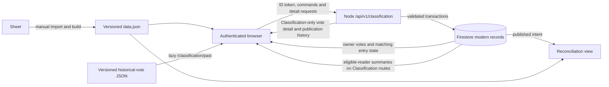

# Classification data and release workflow recommendation

Status: Phase 3 development migration is complete; Phase 4 reader cutover and Phase 5 staged write controls are implemented and locally verified. Development rules/indexes, API revision, catalog parity, and the owner-run authenticated read matrix passed. The approved development vote create/edit/delete and full action Draft → Staged → Settled → Re-opened → Delete rehearsals passed guarded checkpoints. A focused frontend fix resolved a disabled Settled Save button. The separately approved dev-only one-action batch Publish on `c34bd7b2` passed: one immutable Unranked → Black 5 snapshot, Published action revision 2, matching summary/state revision 7 milestone, and zero remaining Staged actions. The owner observed the same publication as Awaiting import on the baseline catalog, Matches catalog on the isolated overlay, and Awaiting import again after restoring the original `dist/`. For follow-up feature work, the owner requested the cumulative development `publish` stage to expose votes, actions, and Publish; both the development API and owner-deployed frontend are now verified at `publish` with the baseline catalog and `lpubelts-dev` target. The actual Sheet, GitHub Import, announcement, and production remain untouched. The real release pipeline and production authorization and migration gates remain open as described below and in the [implementation report](./classification-public-data-report.md). This recommendation uses the [functionality and product decisions](./classification-functionality-overview.md), the [frontend data inventory](./classification-data-architecture-capabilities.md), and the [sibling server inventory](../../explore-lpubelts-com-node/internal-docs/classification-server-api-capabilities-overview.md). The award lifecycle and development CORS value below are owner-provided.

## Recommendation

Use **Firestore as the durable source of truth for modern classification data**, with the sibling Node service as the **only writer and the authenticated detail API**. Outside Classification, let the React app subscribe only to the signed-in member's votes and a minimal matching entry-state projection needed to decide whether each own vote is current. Mount the role-gated per-lock summary listener only inside Classification, and fetch other members' complete vote detail only when a lock is expanded there. Fetch published changelogs through bounded, authenticated API requests. Keep the lock catalog and historical-vote archive in their existing release-versioned JSON files. Keep the Sheet update and GitHub Import/build workflow manual for the first public release.

This uses existing Firebase Auth and the sibling service's verified-token/Firebase Admin/API patterns. The signed-in profile listener continues to supply profile data, while a derived `blackBelt` Auth claim will authorize Classification reads and own-vote writes for Black Belt members at public release. It also avoids making a generated public file the source of private vote details or making one HTTP poll per lock stand in for live feedback. A local Phase 2 prototype now adds server endpoints, Firestore rules, and focused tests; deployment, reader cutover, and migration remain separate work. A direct-client alternative appears below.



The recommendation is deliberately a small hybrid: the server owns every mutation and sensitive detail response; Firestore's existing browser SDK supplies the real-time reads. Put the owner-vote and minimal matching entry-state subscriptions in one shared data owner used by lock and scorecard routes. Mount the full summary subscription only for Classification children that use the modern worklist or staged actions, and tear it down on exit; the historical browser does not need it. The lock and scorecard routes must not subscribe to the full summaries or call the other-vote detail API, even for a lock the member has voted on. Do not turn each `EntryActionBar` or lock row into an independent listener. The current `EntryClassificationVote` guard controls rendering only: bundled sample JSON is still loaded by the preview, so actual read-cost savings require this future data-source split.

The compact vote chips in the proposed Classification summary still serve worklist/ranked rows, filters, and the admin preview. `EntryClassificationVote` no longer renders a duplicate “current votes” chip block inside its expanded panel. This UI cleanup does not change the need for route-scoped summary data or the on-demand full vote detail used by that panel.

### Recorded Black Belt authorization decision

For the public release, use `blackBelt: true` in the verified Firebase Auth custom claims as the **only** Black Belt authorization input in the Classification route policy, Firestore read rules, and Node API reader and vote-writer middleware. An `awards` document with `awardId: 'da7759a9'` is the intended eligibility record only after its writer and existing provenance are verified under the [production Security Rules hardening gate](#production-security-rules-hardening-gate); the current owner-writable record alone cannot authorize a grant. Award approval is outside this project. `lockcollections.blackBeltAwardedAt` remains available for other profile features but has no Classification authorization role. The claim is a derived access entitlement, not the source of award history. A Black Belt claim grants Classification reads and the ability to create, edit, and delete that member's own vote. It does not grant `classificationAdmin` or permission to edit another member's vote, manage actions, or publish. Existing `admin`, `classificationAdmin`, `lpuMod`, and `classificationTeam` claims retain their current access.

Initial claims for current Black Belts are set manually in each environment. The owner reports development claims already set for relevant users and 112 Black Belts plus three test accounts in production; these counts were not verified for this recommendation. The existing [migration script](../scripts/migrateBlackBelts.js) queries `awards` by the Black Belt award ID and skips users with an explicit `blackBelt: false`. A future cron process will check new awards and set `blackBelt: true` only for newly eligible users without an explicit `false`. Revocation is manual by setting `blackBelt: false`; automation must never change that value. Preserve unrelated custom claims on every update. Mirror **all** Auth custom claims in `user-claims-info/{uid}` for internal verification and lookup; this collection is inaccessible to the site and must never be used for authentication. The current migration script writes the mirror only when changing the Auth claim, so mirror reconciliation remains implementation work. An audit tool is planned, with requirements still to be defined.

Before public reads depend on the claim, validate protections on the award-writing path used by the future cron, implement mirror reconciliation and claim-only access checks, and update the site's token observer/refresh behavior so claim changes reach the UI. Define the acceptable delay for manual revocation to take effect in already-issued tokens. The Firebase Auth project is shared by the default and `lpubelts-dev` Firestore databases, so the claim is user-level across both even when award checks run against one database; test that scope explicitly. [Firebase custom claims](https://firebase.google.com/docs/auth/admin/custom-claims), [ID token observer](https://firebase.google.com/docs/reference/js/auth.auth).

## Source of truth and record contracts

The following are logical collections and fields, not a migration script. Use stable, deterministic IDs and keep the source pair fields without trusting browser-provided ownership. Keep `entryId` equal to the static catalog's lock ID. Store server timestamps as Firestore timestamps and serialize ISO dates at the API boundary. Keep a numeric `revision` for conditional edits and an `idempotencyKey`/operation record for retried commands.

### Phase 1 target inventory from source and read-only metadata

| Boundary | Development | Production | Confirmation still needed |
| --- | --- | --- | --- |
| Firebase project and Firestore database | `lpubelts-dev` is provisioned in `lpu-belt-explorer` as `STANDARD`, `FIRESTORE_NATIVE`, location `nam5`; the frontend selects it with `VITE_DEV_FIRESTORE=true`, and the sibling API contract requires that database ID in development. | `(default)` is also provisioned in `lpu-belt-explorer` as `STANDARD`, `FIRESTORE_NATIVE`, location `nam5`; the normal frontend selects it, and the sibling runtime treats it as production access. | The repository's Firebase CLI `default` alias points to `lputest`, so commands must name `lpu-belt-explorer` explicitly. Confirm the deployed API process's protected database setting at cutover. |
| Firestore rules | At the Phase 1 inspection, the active named-database release was `cloud.firestore/lpubelts-dev` and its source was byte-identical to the default release; a whitespace-normalized [review baseline](./firestore-rules-deployed-baseline-2026-10-13.rules) is retained. | At the Phase 1 inspection, the default release was `cloud.firestore`; both had been updated on 2026-10-13 by the same account. | The [implementation report](./classification-public-data-report.md) records ruleset IDs, timestamps, original hash, and last publisher. Phase 2 added a tracked, baseline-preserving rules prototype and configuration for **both** databases, but the designated maintainer and deployment review remain open before enabling Classification reads. |
| Node API | The deployment topology designates `https://api-dev.lpubelts.com`; local server code mounts the versioned API at `/api/v1` with an empty prefix. The frontend's `apiServerUrl` fallback is now `https://api-dev.lpubelts.com`. The owner reports development `CORS_ORIGIN=https://lpubelts.com,https://dev.lpubelts.com,http://localhost:3000`. | The topology designates `https://api.lpubelts.com/api/v1`. The frontend's `nodeServerUrl` default selects the production host when `VITE_DEV_FIRESTORE` is not `true`, while `apiServerUrl` still defaults to the development host. | The Phase 2 development URL and allowed origins are decided. Smoke-test the deployed development proxy and CORS; set and verify `VITE_API_SERVER_URL=https://api.lpubelts.com` for production before release. The protected environment file was not opened for this review. |
| Black Belt award | `awards` records with `awardId` `da7759a9` are the intended eligibility source, pending trusted-writer and provenance checks. `lockcollections.blackBeltAwardedAt` remains profile data. Both databases share Firebase Auth. | Same code paths, subject to the selected database; claims are user-level across both databases. | Implement manual initial setup and a new-award grant process that preserves explicit `false`, mirrors Auth claims, and audits mismatches. Complete the [award hardening gate](#production-security-rules-hardening-gate) before automating grants. |

Database and rules findings above were verified against live management metadata, without reading Firestore documents. The complete evidence and remaining ownership work are tracked in the [Phase 1 implementation report](./classification-public-data-report.md).

| Logical record | Key and authoritative content | Role |
| --- | --- | --- |
| `classificationVotes/{voteId}` | One modern vote per lock/member: stable vote ID derived from the `(entryId, userId)` pair, `entryId`, `userId`, original `displayName`, `votedBelt`, bounded `comment`, optional validated `mediaUrl`, `createdAt`, `updatedAt`, `revision`, migration provenance (`sourceId`, `source`) where needed. | Canonical editable vote across decisions and reopening. The owner or classification admin can update all editable fields or delete it. The server takes actor and timestamp from verified identity/server clock, never from the form. Synthetic `u_...` users are importable but cannot authenticate as those IDs; only an admin can edit/delete their records until explicitly attributed. |
| `classificationEntries/{entryId}` | Per-lock Classification summary: latest decision milestone/status, reopened flag, current nonpublished action ID/status, `hasModernVotes`, `hasPreviousModernVotes`, current vote count/belt counts/consensus/latest vote time, and compact current/previous vote chips (`id`, `userId`, `displayName`, `votedBelt`, `updatedAt`) for the existing row display and filters. Include `revision` and summary update time. | Role-gated live worklist/ranked read model, subscribed only while a Classification route needs it. Derive from current votes and actions in the same trusted write transaction; rebuildable from canonical records. Avoid comments/media URLs here. Static catalog remains authoritative for lock name, assigned belt, and other catalog fields. |
| `classificationEntryStates/{entryId}` | Minimal state for the own-vote indicator: `entryId`, `decisionMilestoneAt`, `reopened`, `voterIds` for matching entries with an owner vote, and `revision`. No other voters' vote chips, belts, comments, media URLs, or aggregate counts. | Shared lock/scorecard data owner queries only states matching the verified UID. Maintain from canonical votes and decisions in the same trusted write path as the full summary. This separate projection prevents a lock-route indicator query from downloading other people's vote data. |
| `classificationActions/{actionId}` | Mutable decision draft: `entryId`, actor, `status`, nullable `action` (`Belt Change`, `Sameline`, `Delete`), target belt or retained-lock ID, changelog note, admin note, `omitChangelog`, timestamps, and `revision`. Published action also stores `publicationId` and `lastPublishedAt`. | Admin-only writes. At most one nonpublished action is current for an entry; enforce this through the entry summary in the same server transaction. Preserve published actions and prevent later mutation/deletion. A new form after publication creates a new action ID. Normalize old sample `omitFromChangelog`/`includeInChangelog` names at import, never carry both forward. |
| `classificationPublications/{publicationId}` | Immutable event with `lastPublishedAt`, verified actor, kind (`batch` or `single`), ordered snapshots of **included** actions, `previousBelt` and intended result, and an optional verified catalog version/fingerprint at publication. Exclude `adminNote`. | Drives the dated changelog, exports, and reconciliation. Store enough names/belts to display it after a lock is renamed or deleted. The snapshot is authoritative for what was announced; later catalog changes do not rewrite it. The comparison uses the currently bundled catalog at read time. |
| `classificationOperations/{operationId}` | Command type, actor, request digest, result IDs, and completion time, retained for a bounded period. | Makes create/publish retries idempotent after a timeout. Return the original result for the same actor/key/payload; reject reuse with different input. |

For a vote's stable key, use `v_` plus the hex SHA-256 digest of the UTF-8 sequence `entryId`, a NUL separator, and `userId`. Keep both pair fields in the document and derive the ID on the server, including during migration; never trust a browser-supplied vote ID for create. This avoids ambiguous concatenation and allows a transaction to check/create the one document for the pair. Preserve each environment's chosen export sample ID as `sourceId` for migration traceability. The development seed has 345 records with no duplicate `(entryId, userId)` pair, invalid belt, or catalog-absent entry ID. The owner plans a final export before production: vote source IDs and unknown-voter `u_...` IDs are regenerated, so rerun validation, record that file's fingerprint, and reconcile identities before importing or re-importing.

### Phase 1 logical and API shape decisions

Use `revision: 1` for a created vote/action/entry summary and increment it on each effective change. An entry summary contains `entryId`, `decisionMilestoneAt` (timestamp or null), `lastDecisionStatus` (`Published`, `Settled`, or null), `reopened` (boolean), `currentActionId`/`currentActionStatus` (nullable), `currentVoteChips`, `previousVoteChips`, `currentVoteCount`, `currentBeltCounts`, `hasModernVotes`, `hasPreviousModernVotes`, `hasConsensus`, `highestVoteBelt`, `latestVoteAt`, `revision`, and `updatedAt`. The effective displayed status is the current action status, else the last decision status, else `Has Votes` or `No Votes` from the current vote count. Each chip contains only `id`, `userId`, `displayName`, `votedBelt`, and `updatedAt`. `hasConsensus` retains the existing rule: at least three votes for one belt and more than half of all current votes. The separate minimal entry-state document carries `voterIds` for **all** modern votes, including previous ones, plus the milestone and reopened flag; joining it with the owner's subscribed vote determines the current indicator without transferring other voters' chips. The static catalog supplies assigned belt, lock name, and other catalog fields. Keep no comments, media URLs, or admin notes in either browser-readable projection.

All new HTTP paths below are relative to `/api/v1/classification`. A successful response uses the existing `{ "metadata": { "source": "firebase", "fetchedDateTime": "<ISO time>" }, "data": ... }` envelope; protected responses use `Cache-Control: private, no-store`. Every API timestamp is an ISO 8601 string. Empty optional values are `null`, and list endpoints return an array, not a missing field. The server derives actor, owner, record IDs, decision timestamps, and catalog comparisons; commands accept only the editable fields listed below.

| Route | `data` shape or accepted command | Access |
| --- | --- | --- |
| `GET /entries/:entryId/votes` | `{ entryId, entryRevision, decisionMilestoneAt, reopened, votes: [{ id, entryId, userId, displayName, votedBelt, comment, mediaUrl, createdAt, updatedAt, revision, isCurrent }], nextCursor }`. Sort by `updatedAt` then `id` for stable bounded pages; only an expanded lock on a Classification route loads all pages and refetches if `entryRevision` changes. | Eligible Classification reader. No admin notes. |
| `GET /entries/:entryId/action` | Current nonpublished action with `id`, `entryId`, `status`, nullable `action`/`updatedBelt`/`samelineTargetId`, `note`, `adminNote`, `omitChangelog`, timestamps, and `revision`; `data: null` if none. | `admin` or `classificationAdmin`. |
| `GET /actions/staged` | Bounded list of staged action projections with the same public decision fields, entry IDs/names, note, and revision, excluding `adminNote`. | Eligible Classification reader; the admin form uses the full action route. |
| `GET /publications` and `GET /publications/:publicationId` | Cursor-paged `{ publications: [{ id, lastPublishedAt, kind, actionCount }], nextCursor }` for the list; `{ id, lastPublishedAt, kind, actorId, actions: [...] }` for detail. Each ordered action snapshot has `actionId`, `entryId`, `entryName`, `previousBelt`, `action`, intended belt or sameline target, `note`, and enough catalog identifiers/names to render after rename/deletion. Never return `adminNote`. | Eligible Classification reader. |
| `POST /votes`; `PATCH/DELETE /votes/:voteId` | Create accepts `entryId`, `votedBelt`, optional `comment`/`mediaUrl`; edit accepts those editable vote fields and `expectedRevision`; delete accepts `expectedRevision`. A successful create/edit returns the complete owner vote with `revision`; delete returns the deleted ID and entry revision. | Verified voting claim and owner; `admin`/`classificationAdmin` may edit/delete another owner while preserving attribution. |
| `POST /actions`; `PATCH/DELETE /actions/:actionId` | Create accepts `entryId`, status/decision fields, note, admin note, and `omitChangelog`; edit/delete requires `expectedRevision`. Return the complete admin action with its new revision, or deleted ID. A Published action is immutable. | `admin` or `classificationAdmin`. |
| `POST /publications` | `{ actions: [{ actionId, expectedRevision }, ...] }` in the intended order; returns the immutable publication and new entry/action revisions. Only eligible Staged actions are included. | `admin` or `classificationAdmin`. |
| `POST /publications/single` | Complete one-entry form decision plus `expectedRevision` of the editable action, or null when creating one. Save and publish that decision atomically; return the same publication shape. Require `omitChangelog=false` and leave all unrelated staged actions untouched. | `admin` or `classificationAdmin`. |

All mutating commands carry `Idempotency-Key`. Reusing a key with the same verified actor and request digest returns the stored outcome; a changed payload returns `409`. A stale `expectedRevision` returns `409` and the current record/revision for recovery. A duplicate vote pair also returns `409` with the existing vote so the form can resume editing. Authentication/authorization failures return stable `401`/`403`; missing resources return `404`. The Phase 2 prototype uses 2,000-character vote comments, 2,048-character HTTP(S) media URLs, 4,000-character notes, default pages of 25 with a maximum of 100, batches of at most 25 actions, and seven-day idempotency records with planned Firestore TTL. The sibling OpenAPI file documents request validation and error codes; these limits still need review against the complete migration source before routes ship.

### Current and previous modern votes

Preserve the preview's simple rule with a durable per-entry milestone. A vote whose `updatedAt` is at or after that milestone is current; an older vote is previous. Once an entry is reopened, **all** modern votes on it remain current until the next Publish or Settle, including while the work item moves through `Pending` or `Staged`. Store this as the entry's `reopened` flag, not as a test of the current action's status. There is still only one vote document per `(entryId, userId)`: editing it updates its fields and `updatedAt`, so it can move from Previous votes back into Current votes. Deleting it removes it from both lists. Vote records carry revision numbers for safe edits, but no historical vote copies or snapshots are required. The previous-votes section always shows the current contents of older vote documents, not what a voter said at the time of an earlier decision.

The Phase 5 local form can now save an existing previous modern vote through its stable ID and revision. `getUserVote()` returns the owner's one stored vote whether current or previous, while `getCurrentUserVote()` controls its current display; this prevents a second create for the same pair. `VoteView` offers Edit to the owner or classification admin when the vote stage is enabled, while suppressing it on changelog and historical routes. Retain the `Settled` rule that blocks a first vote while allowing an existing owner vote to be edited, as recorded in the overview. The separate historical-vote browser remains read-only.

Set the entry milestone once when a decision transitions to `Published` or `Settled`, using the server's decision time; editing an already settled note must not move the boundary. That transition also clears `reopened`. Seed the milestone at migration from the existing ranked lock's `currentBeltDate` where appropriate, then keep it independent of future Sheet-import belt timestamps. An entry without a prior decision or valid seeded belt date has a null milestone, making its modern votes current. The import can stamp `currentBeltDate` **days after** publication; applying that later date as a new live boundary would incorrectly turn intervening edits into previous votes. Reopening sets `reopened` without creating another vote or milestone; a later edit updates the existing record. A subsequent Publish/Settle creates the next milestone. Store the milestone and status centrally so the summary, detail API, and owner indicator all use the same rule.

Use each chosen export's `createdAt` values as the accepted migration timestamps, retaining their order within each lock; they represent export time plus vote-column offsets, not original vote dates. Preserve that export's source IDs in provenance after validating pairs and synthetic identities. Do not include the ten preview admin actions or bundled sample publication in production. `src/data/classification-votes-historical.json` remains a separate, manually corrected, lazy-loaded archive; its synthetic dates never define modern milestones.

### Mutation and publication invariants

The server verifies Firebase ID tokens and checks actual claims on every command. Voting requires a verified `admin`, `classificationAdmin`, `lpuMod`, `classificationTeam`, or `blackBelt` claim, matching the current `classificationVote` UI policy; possession of a recorded lock is not a voting prerequisite. A Black Belt may create, edit, and delete only their own vote. An admin can edit another person's vote while preserving that vote's `userId` and original `displayName`. Vote deletion is owner or `admin`/`classificationAdmin`. Only those two admin claims may create/edit/delete actions or publish. Do not accept `adminEnabled`, `qaUserEnabled`, a role preview, client `userId`, display name, status timestamp, or a client belt value as proof of access. Validate belt enum, allowed action/status combinations, lock and sameline target IDs, text lengths, URL scheme/length, and omitted versus included changelog state on the server.

Use an expected `revision` on edit/delete to return a conflict with the current record if two reviewers race. One transaction should write the canonical vote/action, affected entry summary, and operation result. Recompute an entry summary from its bounded votes when necessary (the planning range is at most about 700 votes across 500 active locks, not 700 per lock). Do not maintain a global counter document written by every vote. Firestore transactions are atomic and retry on conflicting reads; transaction callbacks must have no external side effects. [Firebase transaction documentation](https://firebase.google.com/docs/firestore/manage-data/transactions).

Batch Publish accepts an explicit ordered list of staged action IDs with matching expected revisions; the server rechecks status and `omitChangelog`, then atomically marks **only included actions** `Published`, sets their `updatedAt` and `lastPublishedAt` to one publication time, advances affected entry milestones, and stores one immutable publication snapshot **of the actions**. Vote documents are not copied. If no action qualifies, reject the command without changing state. `Publish Now` performs the same operation for exactly one saved form decision, without staging or publishing unrelated actions. For a single publication, require `omitChangelog=false`; otherwise the form must resolve that conflicting intent before submission. Treat retry with the same idempotency key as the same publication, so a lost HTTP response cannot produce a second changelog. Validate transaction size as part of the 25-action prototype; if it approaches Firestore limits, keep an explicit prepared/finalized state and do not expose a partial publication as published.

Publication records **intent**, not catalog completion. The Sheet remains the editing source for assigned belts; `data.json` remains the site's displayed belt until the manual Import/build completes. A publication transaction must never pretend it also updated the Sheet or static catalog. The reconciliation view joins each immutable action snapshot to the currently bundled `data.json` by `entryId`, showing intended action/target versus current site belt, retained sameline lock, presence/deletion, and catalog build/version date. Missing IDs and incompatible action types need explicit “needs review” results. This is a manual comparison view, with no Sheet display validator or implementation-status tracker.

The current `src/data/data.json` is an array without a top-level build/version field. Phase 4 should supply a build identifier or content fingerprint for the bundled catalog before displaying a precise version/date in reconciliation. Until then, show the compared catalog state without inventing an import timestamp; the publication's optional catalog reference must also stay null unless the server can verify which catalog it read.

## Read flows and access policy

| Surface | Recommended read and freshness | Authorization and shape |
| --- | --- | --- |
| Lock list and scorecard owner indicator | One `classificationVotes` query for the signed-in UID, plus one `classificationEntryStates` query with `voterIds array-contains uid`, shared above individual rows and updated via `onSnapshot`. Match both to static entries in memory and show the belt only when the milestone/reopened state says it is current. Reuse the already-mounted full summary inside Classification, but never mount it for an ordinary lock or scorecard route. Avoid copying canonical votes into `lockcollections` for the first release. The former Classification lock feature filter is removed. | Rules permit only the verified owner's vote query and eligible readers' minimal matching-state query. No browser writes. None of these responses contains another person's vote. Admins looking at another member use the detail API inside Classification, not an owner-query impersonation. |
| Active worklist and ranked browser | One query/listener over `classificationEntries` while those routes are mounted. Join all returned summaries with the static catalog once, then preserve current client search, filters, sort, active/ranked membership, vote chips, and statistics. Admin reviewers see live updates; other eligible readers can use the same path and a visible refresh/reconnect state. | Rules allow only verified `admin`, `classificationAdmin`, `lpuMod`, `classificationTeam`, or `blackBelt` claims. Keep voter names/chips here only because the whole summary is role-gated. No comments/media URLs in summaries. |
| Expanded lock vote detail, including Previous votes | `GET /api/v1/classification/entries/:entryId/votes`, returning that lock's modern vote documents partitioned by the stored milestone/reopened state. Fetch only after expansion on a Classification route, refetch after mutation or summary revision change, and discard the response when leaving Classification; cap results and paginate if the prototype shows a need. The `/locks` panel uses the owner's subscribed vote and displays it only when current, matching the preview. | Same eligible-reader claim policy, checked from the verified ID token. `Cache-Control: private, no-store`. Return comments/media URLs only here (plus the owner's own-vote response). |
| Admin form and current staged changelog | Summary gives status/entry IDs; fetch full nonpublished action(s) on demand or in a small bounded admin request. Mutations use `POST/PATCH/DELETE` with expected revisions. | Admin claims for write. Eligible readers can see staged decisions and their changelog notes, matching the current staged preview, but `adminNote` is returned only to `admin`/`classificationAdmin`. Pending/draft/reopened decisions are admin-only beyond the compact status in the entry summary. Published snapshots never expose `adminNote`. |
| Published changelog list/detail | Page dates and IDs through `GET /api/v1/classification/publications`; fetch one immutable snapshot by ID for `/classification/changelog?id=...`. | Eligible-reader API; no-store response. Retain `lastPublishedAt` naming throughout. Snapshot is sufficient without modern vote details. |
| Historical browser | Existing lazy JSON import at `/classification/past`. | Existing route visibility; it is a downloadable static asset, so do not describe it as backend-private. |

The owner indicator has a subtle dependency: a vote's `updatedAt` must be compared with its entry's milestone, unless the entry is reopened. The minimal matching-state query keeps that status live outside Classification routes without one request/listener per row or any other member's vote chips. It needs an index for `voterIds` and a query that rules can authorize. A profile copy would add another source to synchronize and is not needed initially. A render guard alone does not save Firestore reads or bundle bytes if a broader listener or static vote import has already loaded the data. The removed Classification lock feature requires no static ID seed, compact feature collection, or signed-in feature listener.

Implement explicit loading, permission-denied, stale/reconnecting, and retry states. A listener reflects successful writes, but browser offline caching is not a guarantee that another user's changes are current. Do not show a stale cached worklist as live without a freshness indication. Firestore listener reads are charged for initial results and subsequent document changes, and reconnect behavior depends on persistence settings; measure with the target edition and real usage before setting a cost budget. [Firebase listener billing](https://firebase.google.com/docs/firestore/pricing).

For client reads, add a tracked rules file, named-database deployment plan, and emulator tests **before** enabling the paths. Rules should allow the vote query only when constrained to the verified owner UID; the minimal matching-state and Classification-summary queries only to eligible reader claims, including `blackBelt`; and no browser writes to any classification collection. Do not authorize from a public profile summary or UI flag. Rules do not filter an unsafe query into a safe one; test the exact intended query shapes. Server Admin SDK access bypasses Firestore rules, so the API must independently enforce the same verified-claim reader/write policy. [Firebase custom claims](https://firebase.google.com/docs/auth/admin/custom-claims), [secure queries](https://firebase.google.com/docs/firestore/security/rules-query).

Use the existing `/api/v1` route/service structure in the sibling repo, with OpenAPI, readable API guide, fixtures, and Supertest/service tests. The frontend's local `apiServerUrl` fallback is `https://api-dev.lpubelts.com`, and callers append `/api/v1`; the production build must supply `VITE_API_SERVER_URL=https://api.lpubelts.com`. Smoke-test the deployed development mount and CORS before wiring protected requests. Keep authenticated responses `private, no-store`, return stable 401/403/404/409 errors, and use bounded rate limits suitable for the small reviewer group.

## Why this shape at the expected scale

The owner-reported ceiling is roughly **700 modern votes across 500 active locks**, at most **25** simultaneous admin/staged locks, and **two or three concurrent reviewers**. The current regenerated modern file has 345 votes across 222 entry IDs, with at most six votes on one entry; these are observed counts, not a capacity bound. A compact summary per participating lock means an initial Classification listener would read on the order of hundreds of small documents, plus changes, **only while Classification is mounted**. The owner-vote and minimal matching-state queries outside Classification are proportional to that member's votes and contain no other vote records or chips. These are planning estimates, not measured cost or latency. Worklist filtering across 1,126 static locks can stay in memory. This keeps the present voter/belt filters and consensus definition: statistics use every **current** vote, while vote chips can be narrowed by the filter. A summary must carry enough role-gated search data to preserve voter-name search; omitting that field would be a deliberate product change.

Creating one listener for every lock/scorecard row would multiply reads and subscriptions. Shipping all comments and media URLs in static JSON would expose them to anyone who downloads the bundle. A generated summary refreshed on an export schedule would lag behind the required own-vote and admin updates. The separate minimal state adds a small update/read cost but prevents ordinary lock browsing from downloading other voters' chips; the full summary and detail costs begin only inside Classification. Firestore document/listener and index charges vary by edition, which is why the physical query and cost plan must be checked against the actual database before rollout.

### Alternative: direct Firestore client reads and writes, trusted publisher

If keeping all ordinary vote/action CRUD in the frontend is more important than reusing the Node API, let the client use Firestore queries and writes, with a trusted Function or API command for atomic batch/single publication. This reduces routine write endpoint work and can give all eligible readers live detail. It makes the deployed ruleset the main validator for owner/admin writes, immutable history, field allowlists, and role checks; it still needs backend publication logic and likely a server-built summary. The Phase 2 rules prototype denies browser Classification writes, so this alternative would require a separate rules design and emulator test pass. It also pushes more private vote data to each client unless queries remain carefully bounded. I recommend it only if the Node API's release cadence or availability makes the server-owned write path impractical.

### Compact Classification catalog artifact

`scripts/import.js` now generates `src/data/classification-catalog.json` from the exact bytes it writes to `src/data/data.json`, after `currentBeltDate` has been assigned. The v1 shape is:

```json
{
  "schemaVersion": 1,
  "catalogVersion": "sha256:<SHA-256 of the exact generated data.json bytes>",
  "generatedAt": "2026-10-13T00:00:00.000Z",
  "entries": [
    {
      "id": "3ac43ea8",
      "name": "Any China Padlock (granite look)",
      "version": null,
      "belt": "White",
      "currentBeltDate": null
    }
  ]
}
```

Include **all** catalog locks, including Unranked locks and locks without current votes, because new votes, admin actions, and sameline targets may reference any catalog ID. Sort entries by `id` for stable diffs. `name` is the frontend's trimmed `entryName(entry, 'short')`; `version` is the source version string or `null`, allowing the API to reproduce the current versioned sameline-target label without storing `makeModels`. `belt` is the assigned catalog belt, including `Unranked`. `currentBeltDate` is a parseable ISO timestamp or `null`; the Phase 3 importer seeds a milestone from it only for ranked locks, and later catalog refreshes never advance an existing decision milestone. `generatedAt` is import time, not proof of deployment time. `catalogVersion` identifies the exact full catalog artifact used by that frontend release; calculate it from the bytes written to `src/data/data.json`, not from the compact file containing the hash.

The generator rejects duplicate/blank IDs or names, invalid belts, and malformed dates. `scripts/copyFiles.js` publishes the compact file with `data.json`; the build workflow verifies their exact pairing before deployment. The development-published revision had 1,126 entries and an approximately 180 KB compact artifact, compared with 2.8 MB for `data.json`; the latest checked-in revision has 1,127 entries. The sibling API loader validates the object schema, uses its names and belts, exposes the version, and reopens the file on each lookup so an atomic replacement at the same path takes effect without restarting the server. It also reads the old full-array format during the development transition. The owner verified the earlier development snapshot; a fresh active-version check is required before migration. Publication snapshots do not yet record catalog provenance.

For production, the frontend `Build-N-Deploy` workflow deploys the verified compact artifact to `/home/lpubelts_api/apps/api-server-prod/shared/snapshots/classification-catalog.json` after the Pages deployment. It uploads to a temporary name, checks its SHA-256 on the server, and atomically replaces the active file. This requires a one-time `github-pages` environment setup in the frontend repository: `SFTP_HOST`, `SFTP_PORT`, `SFTP_USER`, and `DEPLOY_ROOT` variables, plus `SFTP_PRIVATE_KEY` and `SFTP_KNOWN_HOSTS` secrets. `DEPLOY_ROOT` must be `/home/lpubelts_api/apps/api-server-prod`, and the API's `CLASSIFICATION_CATALOG_PATH` must point to the absolute file above. Configure the API with the updated loader in a separately authorized release. Once set up, later catalog releases need no API restart or manual file refresh. The workflow fails before site deployment when its remote configuration is absent.

For development, the separate manual `Publish Classification catalog to development` workflow validates `src/data/data.json` and `src/data/classification-catalog.json` from `main`, then uploads the compact file to `/home/lpubelts_api/apps/api-server-dev/shared/snapshots/classification-catalog.json` with the same checksum and atomic activation. It uses the frontend `github-pages` environment's existing SSH settings and does not run Import, rebuild the site, or touch the production catalog. The workflow requires `main` because those SSH credentials can reach production; a separately scoped development key would be needed before accepting arbitrary branches. Run it when choosing a reviewed catalog version for development migration or testing. The updated development API loader sees later file replacements without a restart; first loading a changed `.env.development` or newly uploaded API code still requires a normal development API restart.

### Production Security Rules hardening gate

The tracked rules retain legacy collection access from the deployed baseline. The owner moved profile, evidence, award, ranking-request, and raffle rule hardening to post-launch. The public activity-cache cutover remains part of pre-launch work; a trusted Black Belt eligibility source remains a prerequisite before any automated award-to-claim grant. The following findings describe the remaining work and do not establish the contents of the currently deployed production ruleset. Develop changes against synthetic data and test affected existing client workflows in the emulator before a separately approved rules release.

| Finding | Required change and release check |
| --- | --- |
| `awards` permits a signed-in member to create or update their own record with any `awardId`. The planned Black Belt grant process selects records with `awardId: 'da7759a9'`, so trusting that query alone would turn a client-written record into an entitlement. The cron is not yet active. | Establish a trusted eligibility source before automated grants. Either make Black Belt award creation/update server-only after moving the current Reddit, Discord, and unclaimed-award import paths to a trusted writer, or split verified entitlement records from client-submitted award activity and have the grant process read only verified records. Reconcile existing award provenance before initial grants; test that a member cannot create, alter, or replay a Black Belt eligibility record, while approved award imports still work. Keep manual `blackBelt: false` revocations authoritative. |
| Production `query-cache` still permits unauthenticated writes, including replacement or deletion of another member's activity cache. Other members' scorecards need a public activity payload. | Preserve public reads of the legacy collection but do not trust its existing records: an attacker could already have forged a version 2 marker. The Phase 6 source reads a new server-owned `activity-cache`, populated by evidence/award triggers, with direct-query fallback for absent records. Deny browser writes to both collections and test anonymous and cross-user write denial plus ordinary activity refresh/invalidation. The development cache cutover is deployed; production deployment and trusted backfill remain separate release work. |
| Client writes to `lockcollections`, `evidence`, `awards`, `ranking-requests`, and `raffle-entries` lack complete field, type, and size validation. `lockcollections` blocks only the `admin` field, leaving other derived or internal fields writable. | Inventory each legitimate create, update, and delete shape first. Add collection-specific required/allowed fields, value types and size bounds, immutable owner IDs, and field-level update allowlists; keep authorization tied to verified identity/claims. Move any derived, approval, or internal fields that clients must not set to trusted code. Test malformed, oversized, cross-user, and create-then-update bypass attempts along with existing profile, evidence, ranking-request, and raffle flows. |
| A manual custom-claim removal may leave an already-issued ID token usable until refresh. | Decide and document the acceptable revocation delay before public reads. If immediate denial is required, add a server-controlled per-user revocation marker checked by Firestore rules and the API, then test stale-token reads and writes, claim refresh, and manual `false` revocation. Never use `user-claims-info` or a client-writable profile as the authorization source. |

Treat the first award row as a prerequisite to any Phase 6 grant job, the cache row as a pre-launch release check, and the remaining legacy collection rule work as post-launch. Until hardened, existing owner-writable award and profile data must not become an authorization source; ranking requests and raffle entries retain their current client-write exposure. The current Classification vote and matching-state query rules already require the intended owner/reader claims; preserve those boundaries while hardening legacy paths. Rules are not query filters, and the server Admin SDK bypasses them, so validate server-written projections and keep the Node API's own verified-token checks. [Firestore query rules](https://firebase.google.com/docs/firestore/security/rules-query), [field allowlists](https://firebase.google.com/docs/firestore/security/rules-fields), [server SDK access](https://firebase.google.com/docs/firestore/client/libraries), [custom-claim propagation](https://firebase.google.com/docs/auth/admin/custom-claims).

## Delivery sequence and release gates

1. **Confirm remaining contract inputs.** Use the verified `lpubelts-dev` and `(default)` Standard-edition targets and deployed-rules baseline; confirm who will maintain the tracked rules source. Use the decided development API base URL and `/api/v1` mount. Treat `awards` records with `awardId: 'da7759a9'` as candidate Black Belt eligibility data until trusted-writer and provenance checks pass. Freeze the logical schema, response shapes, and milestone behavior above. Develop with synthetic fixtures and emulators; do not probe production documents as a shortcut.
2. **Build the backend and rules first.** Add the server service/routes, transactional vote/action/publication operations, rebuildable full summary and minimal entry-state logic, indexes for owner/state/summary queries, rule-gated client reads, and denied-access/concurrency/idempotency tests using synthetic reader claims. Keep the old UI read-only until auth and rules pass in the target development environment. A backup/export and rollback procedure for the new collections should be written before migration.
3. **Migrate modern records into development — completed 2026-10-15.** The checked-in 345-vote, 34-synthetic-user file is the development seed; the owner plans a final export immediately before the production move. Export-time `createdAt` values are migration provenance, not original vote dates. The [development migration runbook](../../explore-lpubelts-com-node/internal-docs/classification-development-migration.md) documents the local `plan` and approval-gated live `inspect`/`apply` modes. The owner confirmed the active development API catalog version `sha256:094da826dc82f23d0cbf0e8f9219549b1589a14a468843fe46b20223dfe08288`, matching the current checked-in full/compact catalog pair and selected private manifest. The approved backup export completed before migration. A read-only inspection found all six Classification collections empty; the separately approved write rechecked them, created 345 votes, 239 summaries, and 239 minimal states using create-only preconditions, and verified all 823 planned documents with no missing or conflicting records. Source-ID and synthetic-user mappings are preserved in the private manifest. No action, publication, or operation documents were imported. Rerun all record checks on the final production export and reconcile regenerated source/synthetic IDs in a separate production manifest. Production migration and every future live-data script/export require separate explicit authorization under the repository safety policy.
4. **Switch readers in one owned path.** Remove sample imports from `ClassificationContext` and `LockDataProvider`; keep shared owner-vote/minimal matching-state subscriptions and a full summary owner scoped to the Classification children that use modern rows. Add other-vote detail fetches only on expansion inside Classification, published action snapshots on date selection, loading/errors, and reconciliation against the loaded catalog. Make the vote form load the one effective owner vote even when its chip is marked previous. Keep `/classification/past` on the static historical archive without a modern summary listener. Compare live-derived rows with the preview's active/ranked membership, current/previous votes, filters, stats, and exports. Verify that `/locks` and scorecard neither subscribe to full summaries nor request other-vote detail.
5. **Enable writes and publish in stages.** The API's protected `CLASSIFICATION_WRITE_STAGE` and frontend build's `VITE_CLASSIFICATION_WRITE_STAGE` use `read` (default), `vote`, `action`, and `publish`. The server refuses mutations above its active stage with `503 writes_disabled`; this rollout gate complements verified-claim and owner/admin authorization. Promote the server stage before the matching frontend build, keeping production at `read` until Phase 6. Enable vote save/edit/delete after claim-only Black Belt own-vote, nonowner denial, admin-permission, and concurrent-edit tests; then action draft/stage/settle; then batch and single Publish. Test a publication followed by a delayed Sheet import, a repeated Publish request, a simultaneous admin edit, a reopened lock, and an absent catalog lock. The manual operator path remains: export/announce the immutable publication, update the Sheet, run Import, let the site and catalog deploy, then use the reconciliation view. The production workflow replaces the API's catalog snapshot automatically after the site deployment, and the API loader observes the new file without restart. The 2–3 day catalog freshness target is operational.

The development vote create/edit/delete rehearsal and its now-removed Locks filter add/remove observation are historical results. The action-stage trial found that moving a Staged Belt Change to Settled must clear both its target belt and its decision type in the frontend form; otherwise Save is disabled. The handler now clears both for Settled and Re-opened; the focused component test and owner-deployed development build passed. The same action then reached Settled at revision 3 and Re-opened at revision 4, retaining its decision milestone and prior Settled status without publication. For an action-stage rehearsal, choose a test entry that is visible in the admin UI before any action exists: a ranked lock with no current/previous vote is absent from both active and ranked Classification lists, whereas an Unranked lock remains on the active route. Deleting the Re-opened action advanced summary/state to revision 5, removed the current-action reference, and left the decision milestone and prior Settled status in the summary, as explicitly approved. The owner declined any actual Sheet change for the dev-only publication gate. The normal GitHub Import reads the shared Sheet, commits generated catalog files, and triggers a production site build plus production/development API catalog uploads, so a test-only Sheet edit is not development-only. The [implementation report](./classification-public-data-report.md) records the completed isolated batch publication and temporary frontend catalog overlay. The owner confirmed the reconciliation sequence Awaiting import → Matches catalog → Awaiting import after restoring the original baseline `dist/`. The immutable development publication and Published action remain intentional test residue. The single Publish Now path has focused-test coverage but no live rehearsal. The later development feature-work request promoted the API and owner-deployed frontend to the cumulative `publish` stage; both are publicly verified. A real release still needs a separately approved operator plan for announcement/export, Sheet update, Import, catalog deployment, reconciliation, and recovery.
6. **Release authorization and observe.** Complete the production cache cutover and verify manually established initial Auth claims before public Classification reads. Use only the verified claim in the route guard, Firestore rules, and Node reader and vote-writer middleware; test claim-only access, own-vote writes, and the shared Auth project across the default and `lpubelts-dev` databases. Ensure Black Belt alone does not enable admin actions, publication, or edits to another member's vote. The owner moved profile, evidence, award, ranking-request, and raffle rule hardening to post-launch. Do not activate an automatic Black Belt grant from owner-writable award/profile data: a trusted award source and provenance checks are still required before that job. Grant/mirror/audit automation, token refresh, and stale-token revocation policy remain post-launch items 9–10 in the [implementation report](./classification-public-data-report.md). Coordinate frontend, API, rules/indexes, and named-database configuration so a UI never calls missing endpoints or reads a collection before rules are ready. Measure initial listener reads, latency, denied reads, summary rebuild mismatches, and API errors in development. Confirm a safe fallback to the read-only UI if writes fail; never fall back to bundled sample data in production.

Acceptance checks should include authenticated role matrices (including `blackBelt`-claim-only and UI preview modes), new-award grants and manual initial setup, preservation of explicit `false` revocations and unrelated custom claims, mirror parity for changed and unchanged claims, no public access to comments/media URLs, one vote per pair under concurrent submissions, owner/admin deletion, synthetic IDs, immutable **action/publication** snapshots, both publish paths leaving unrelated staged work alone, previous modern vote behavior after edit/reopen/settle without vote copies, summary agreement with canonical votes, and reconciliation against a catalog that is still awaiting import. Add an instrumented route test: `/locks` and scorecard load only own votes and minimal entry state, entering the active/ranked Classification views starts the full-summary subscription, expanding a lock requests other-vote detail, and leaving those views releases both. Existing Vitest coverage for Classification rows/context and new mocked API/rules tests are useful; use a focused browser journey for the full authenticated flow. No live exporter or production deployment is part of routine verification.
